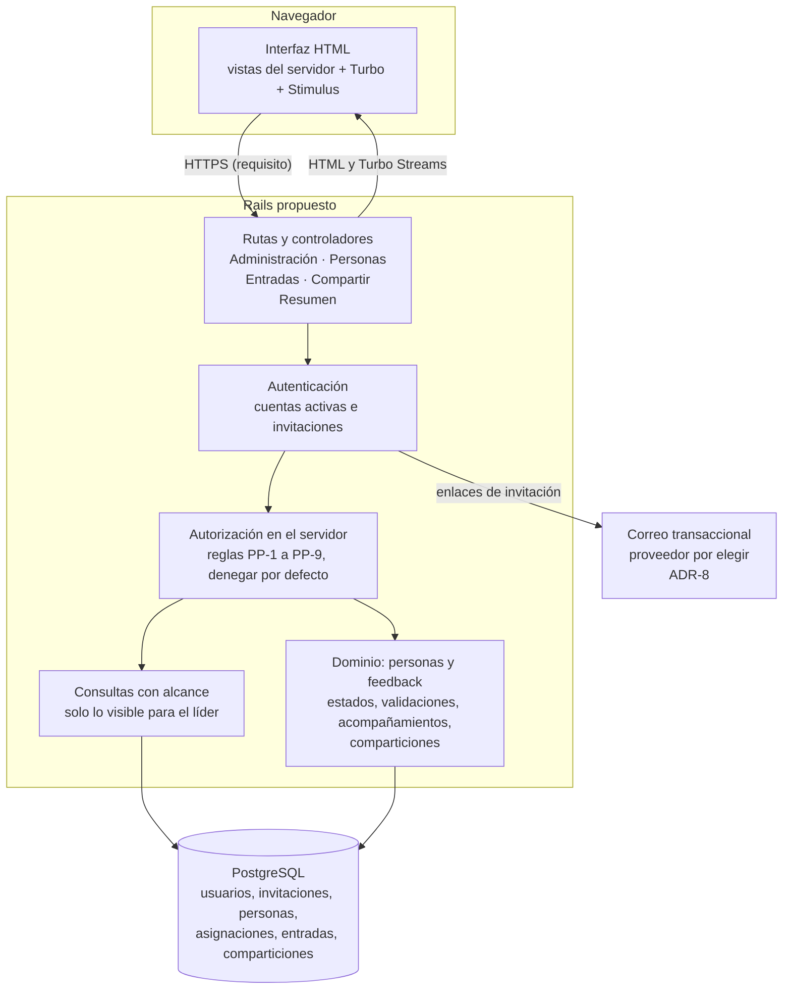
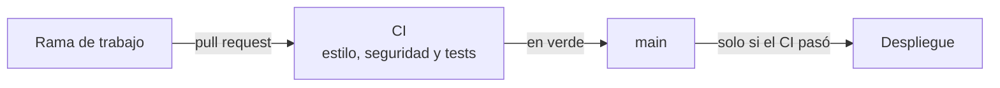
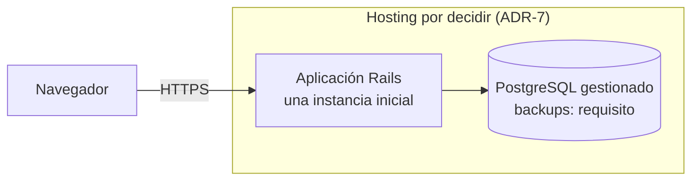
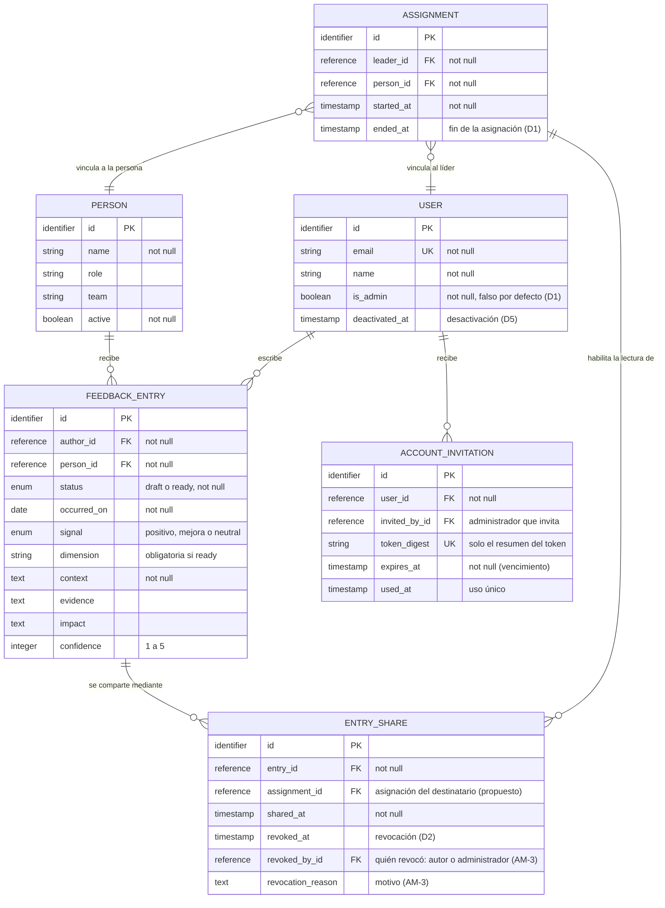

# Growth Log

> **Primera entrega del proyecto final de AI4Devs: documentación.** Todo lo
> que describe es una propuesta para el MVP. Lo marcado **[Por confirmar]**
> es una decisión pendiente de Pablo.

## Growth Log en un minuto

- **Qué es.** Una bitácora web para que **varios líderes** registren feedback
  fechado y concreto sobre las personas que acompañan, y lleguen a los 1:1 y
  a las evaluaciones con evidencia acumulada en lugar de memoria.
- **De dónde sale.** De la visión del producto descrita en la presentación
  «El problema de evaluar de memoria» (10/05/2026).
- **Qué proponemos.** Un MVP de cinco historias con **privacidad por defecto
  y compartición explícita**, diseñado como un monolito web con autorización
  en el servidor. **Todo el diseño de este documento es una propuesta: no
  está construido.**
- **Qué está decidido y qué está abierto.** Pablo decidió D1
  (administración), D2 (compartición), D5 (salida de un autor) y las reglas
  AM-1 a AM-5 que cierran sus ambigüedades. Siguen abiertas D3, D4 y varias
  decisiones de arquitectura (sección 9).
- **Qué son hipótesis.** Capturar en unos 30 segundos, reducir el sesgo de
  memoria y mejorar las evaluaciones son **objetivos**, no resultados
  medidos.

**Niveles de evidencia:**

| Marca | Significa |
|---|---|
| **Propuesto** | Diseño del MVP: arquitectura, modelo, stack, política, criterios, tickets y mocks. No está construido. |
| **Hipótesis** | Un beneficio esperado que habrá que validar con usuarios. |
| **Decidido** | Decisión de producto tomada por Pablo; todavía no implementada. |
| **Decisión abierta** | Depende de una decisión pendiente (D3, D4 o un ADR). |

## Documentos complementarios

| Documento | Qué contiene |
|---|---|
| [prompts.md](prompts.md) | Flujos de trabajo con IA: herramienta, modelo, fase, resultado y criterio humano. |
| [Anexo A. Historias en detalle](anexos/anexo-a-historias.md) | Los 67 criterios de aceptación y la política de privacidad con los criterios que la aplican. |
| [Anexo B. Matriz de confiabilidad](anexos/anexo-b-matriz-confiabilidad.md) | 11 capas: el requisito del MVP y lo que falta decidir o validar. |
| [Anexo C. Riesgos y decisiones de privacidad](anexos/anexo-c-riesgos-decisiones.md) | Riesgos del MVP, decisiones D1 a D5 y reglas AM-1 a AM-5. |
| [Anexo D. Decisiones de arquitectura](anexos/anexo-d-decisiones-arquitectura.md) | Borradores de ADR: contexto, opciones y criterio de cada decisión pendiente. |
| [Anexo E. Notas de los mocks](anexos/anexo-e-mocks.md) | Relación de cada mock con los criterios y las decisiones pendientes. |
| [Anexo F. Registro de prompts](anexos/anexo-f-registro-prompts.md) | Texto de los prompts publicados, con nota de sanitización. |

**Siglas:** H1 a H5, historias; PP-1 a PP-9, política de privacidad; D1 a
D5, decisiones de privacidad; AM-1 a AM-5, reglas que cierran ambigüedades;
ADR-1 a ADR-8, decisiones de arquitectura; HV-1 a HV-6, hipótesis de valor;
PT-1 a PT-12, casos de prueba de permisos; RN-1 a RN-12, riesgos del MVP.

## Índice

0. [Ficha del proyecto](#0-ficha-del-proyecto)
1. [Descripción general del producto](#1-descripción-general-del-producto)
2. [Arquitectura del sistema](#2-arquitectura-del-sistema)
3. [Modelo de datos](#3-modelo-de-datos)
4. [Especificación de la API y rutas HTTP](#4-especificación-de-la-api-y-rutas-http)
5. [Historias de usuario](#5-historias-de-usuario)
6. [Tickets de trabajo](#6-tickets-de-trabajo)
7. [Pull requests](#7-pull-requests)
8. [Estado de confiabilidad](#8-estado-de-confiabilidad)
9. [Decisiones abiertas y riesgos](#9-decisiones-abiertas-y-riesgos)
10. [Plan de trabajo y uso de IA](#10-plan-de-trabajo-y-uso-de-ia)

---

## 0. Ficha del proyecto

| Campo | Valor |
|---|---|
| 0.1. Nombre completo | Pablo Peuscovich |
| 0.2. Nombre del proyecto | Growth Log. **Proyecto personal de Pablo Peuscovich, autor de la idea.** |
| 0.3. Descripción breve | Bitácora para que varios líderes registren feedback concreto sobre las personas que acompañan y lo usen en 1:1 y evaluaciones. Privacidad por defecto y compartición explícita, como propuesta de diseño. |
| 0.4. URL del proyecto | **Pendiente.** La aplicación todavía no está construida. |
| 0.5. Repositorio | Este repositorio contiene la documentación de la entrega 1; el código se sumará en las entregas siguientes. |

---

## 1. Descripción general del producto

### 1.1. Objetivo

**Fuente de la visión:** «El problema de evaluar de memoria», presentación
de 7 diapositivas fechada el 10/05/2026 (fecha del archivo). No se publica
con esta entrega.

**Problema.** Cuando una evaluación depende de lo que se recuerda del último
mes, se pierde el contexto de los meses anteriores, el feedback valioso no
queda registrado y cuesta respaldar las decisiones con ejemplos concretos.
La presentación también señala más sesgo y menos consistencia entre
evaluadores.

**Para quién:**

| Usuario | Rol | Estado en el MVP |
|---|---|---|
| Líder (varios por instancia) | consulta las personas que tiene asignadas, registra feedback sobre ellas, lo revisa y decide qué compartir | **en el MVP** |
| Administrador | invita y desactiva cuentas, crea y edita personas, asigna y termina asignaciones, y puede revocar una compartición concreta sin leerla; serlo no le da lectura de entradas. Una cuenta puede ser administradora y líder a la vez | **en el MVP** (D1, AM-2 a AM-5, decididas) |
| Persona acompañada | es el sujeto del feedback | **sin cuenta en el MVP.** Que vea su propia evolución es una intención de la visión, abierta como D4 |

**Supuesto de adopción (de la visión).** Growth Log no cambia el proceso de
evaluación ni de calibración: cambia cómo se llega a él, con evidencia
acumulada durante el ciclo. **La aplicación no calcula el puntaje de la
evaluación**; la calibración es un uso posible de la evidencia que reúne.

**Hipótesis de valor.** Ninguna está medida; son objetivos a validar.

| # | Qué esperamos | Origen | Evidencia hoy | Cómo se podría verificar (propuesta) |
|---|---|---|---|---|
| HV-1 | Registrar una observación en unos 30 segundos | visión | ninguna medición | cronometrar la captura rápida en una prueba de uso |
| HV-2 | Menos sesgo de memoria: el ciclo completo queda documentado | visión | ninguna | ver si las entradas citadas en una evaluación cubren todo el ciclo, no solo el último mes |
| HV-3 | Evaluaciones más justas y consistentes entre evaluadores | visión | ninguna | piloto con varios líderes y su valoración; no es medible dentro del MVP |
| HV-4 | Feedback más concreto y accionable para los 1:1 | visión | ninguna | revisar con líderes si las entradas incluyen contexto, evidencia e impacto |
| HV-5 | Las personas ven su evolución | visión | — | **fuera del MVP** (D4) |
| HV-6 | No hace falta cambiar el proceso de calibración | visión | ninguna | confirmarlo con los líderes del piloto |

### 1.2. Características y funcionalidades principales

**Recorrido principal del MVP (propuesto):**

| Paso | Historia | Qué hace el líder |
|---|---|---|
| 1 | H1 | ve las personas que tiene asignadas; el administrador las crea y asigna |
| 2 | H2 | registra una observación con contexto, evidencia e impacto |
| 3 | H3 | la anota rápido como borrador y la completa después |
| 4 | H4 | revisa la evidencia que puede ver, por dimensión y en orden cronológico, antes de un 1:1 o una evaluación |
| 5 | H5 | explora el feedback que puede ver y comparte el suyo cuando lo decide |

**«Lista» es un estado; compartir es un permiso de lectura:**

| Concepto | Qué indica | Regla propuesta |
|---|---|---|
| **Borrador** | la entrada está incompleta | privado de su autor; no se comparte |
| **Lista** | la entrada está completa | **sigue privada** del autor hasta que la comparta |
| **Compartida** | otro líder puede **leerla** | solo entradas listas; solo el autor edita y comparte; el destinatario lee mientras mantenga asignación y permiso (D2) |

**Política de privacidad del MVP.** Incorpora las decisiones D1, D2 y D5
de Pablo y las reglas AM-1 a AM-5; el resto sigue siendo propuesta. **Nada
está implementado.**
Regla general: privacidad por defecto y compartición explícita.

| # | Regla |
|---|---|
| PP-1 | Cada líder tiene su propia cuenta. Un administrador la invita con un enlace de un solo uso y con vencimiento para que establezca su contraseña; no hay contraseñas fijas ni se envían en texto plano (D1, AM-5). |
| PP-2 | Un líder accede a la ficha de una persona, y crea, edita, marca como listas o comparte entradas sobre ella, solo mientras tiene una asignación activa. Con la asignación activa ve los nombres de los demás líderes activos asignados, sin sus entradas privadas ni datos de contacto. Una persona puede tener varios líderes (D1). |
| PP-3 | Los borradores solo los ve, edita y marca como listos su autor. |
| PP-4 | Una entrada lista sigue siendo privada del autor hasta que este decida compartirla. |
| PP-5 | Solo el autor, con asignación activa, comparte una entrada propia y lista, de a un destinatario: un líder con cuenta activa que acompaña actualmente a la persona. El destinatario la lee mientras su cuenta siga activa, mantenga la asignación y la compartición no esté revocada; no la edita ni la vuelve a compartir. Revocan el autor, aun sin asignación, o un administrador sin leer la entrada (D2, AM-1, AM-3). |
| PP-6 | El feed y el resumen de una persona muestran únicamente las entradas que el líder tiene permiso para ver. |
| PP-7 | Si un autor deja el equipo, un administrador desactiva su cuenta, que no se borra: no puede iniciar sesión y sus sesiones abiertas se invalidan. Sus entradas y su autoría se conservan; las compartidas siguen disponibles para destinatarios con permiso vigente y las privadas quedan sin acceso ordinario, también para el administrador (D5, AM-2). |
| PP-8 | Un administrador invita y desactiva cuentas, crea y edita personas, asigna y termina asignaciones, y puede revocar una compartición concreta viendo solo los metadatos mínimos para identificarla. Administrar no da permiso para leer entradas, crear comparticiones ni editarlas. Nunca se puede desactivar ni quitar el rol al último administrador activo. Una misma cuenta puede administrar y acompañar personas (D1, AM-2 a AM-4). |
| PP-9 | Mientras su cuenta esté activa, un autor conserva la lectura de sus propias entradas, incluidos los borradores, aunque termine su asignación. Sin asignación no las edita, no las marca como listas ni las comparte, pero puede revocar sus comparticiones. La autoría no da acceso a la ficha de la persona ni a entradas ajenas: se muestran solo los datos mínimos para identificar sus entradas (AM-1). |

**Decidido para el MVP:** la consulta cronológica de la evidencia forma
parte de H4 (criterio 4.13). **Uso posible, sin funcionalidad propia:** la
calibración; la aplicación no calcula puntajes. **Fuera del MVP:** el acceso
de la persona acompañada (D4), los enlaces de evidencia externos, y la
transferencia de autoría o la recuperación administrativa de entradas
privadas (D5).

### 1.3. Diseño y experiencia de usuario

**Propuesto:** una navegación con «Personas» y «Feedback». La ficha de cada
persona concentra el resumen por dimensión, el acceso a la «Captura rápida»
y la lista de entradas visibles. La sección «Feedback» es el feed con las
entradas que el líder puede ver. Cada entrada muestra si es propia o
compartida. Los textos dicen «Marcar como lista» y «Compartir», nunca
«Publicar», para no confundir marcar como lista con compartir.

**Mocks del recorrido.** Diseño propuesto para el MVP. Los permisos y la
compartición que muestran siguen las decisiones D1 y D2, pero no están
implementados.

Las imágenes **no son capturas de un sistema existente**: la aplicación
todavía no está construida. Son pantallas armadas para la entrega, con
nombres, equipos y feedback inventados. Cada una lleva la marca «Mock —
propuesta del MVP · Datos ficticios». La relación de cada pantalla con los
criterios y las decisiones pendientes está en el
[Anexo E](anexos/anexo-e-mocks.md).

**1. Ficha de una persona (H1, H4)**


Resumen por dimensión que distingue entradas propias y compartidas, y vista
cronológica por fecha del hecho (4.13), con filtros por estado, señal y
dimensión (4.6). Es la vista del líder: las asignaciones las gestiona un
administrador (D1), y el líder ve los nombres de los demás líderes activos
asignados (1.18). El resumen no es un puntaje.

**2. Captura rápida de feedback (H3)**


Formulario corto desde la ficha. Se guarda como borrador visible solo para
su autor (PP-3, propuesta). Registrar en unos 30 segundos es un objetivo
(HV-1), no un resultado medido.

**3. Entrada lista con la acción de compartir (H5)**


La entrada está lista y sigue sin compartir (PP-4, propuesta). El
destinatario está seleccionado (casilla con tilde), pero la acción no se
confirmó: no hay destinatarios hasta pulsar «Compartir». Solo aparecen
líderes activos asignados a la persona, como decide D2.

**4. Feed con filtros (H5)**


Solo entradas propias y listas compartidas con el líder (PP-6, propuesta),
con filtros por estado, señal y dimensión (5.2) y paginación. Las etiquetas
de origen distinguen «Tuya · privada», «Tuya · compartida» y «Compartida con
vos»; la leyenda debajo de la tabla las explica. Los filtros de **origen y
persona** que muestra el mock son **propuestas por confirmar**: no forman
parte de los criterios actuales.

**Sin ilustrar:** las acciones del administrador (invitar y desactivar
cuentas, crear y editar personas, asignar y terminar asignaciones, revocar
una compartición concreta), el establecimiento de la contraseña desde una
invitación, la revocación por el autor y la vista mínima de un autor sin
asignación. Están especificadas en H1, H3 a H5, MVP-BE-2 y MVP-BE-1.

### 1.4. Instrucciones de instalación

**No aplica todavía:** el MVP todavía no tiene código. Se documentará al
construirla. La lección 1 no exige instalación en esta entrega.


---

## 2. Arquitectura del sistema

**Todo lo de esta sección es propuesto.** Ningún componente, permiso, CI,
backup ni despliegue del MVP existe todavía; son requisitos hasta que se
implementen y verifiquen.

### 2.1. Diagrama de arquitectura



**Correo transaccional:** requisito del MVP para enviar los enlaces de
invitación (AM-5); el proveedor está por elegir (ADR-8) y los correos no
incluyen contenido de feedback. **Integración opcional, todavía sin
dibujar:** un servicio de seguimiento de errores, sin contenido de feedback
(ADR-8).

**Por qué un monolito encaja (propuesto).**

- Un equipo de una persona y un producto con pocos usuarios: un solo
  servicio es más simple de construir, probar y desplegar.
- La regla central, quién puede ver qué entrada, vive en un único lugar y se
  aplica igual a vistas, feed y resumen.
- Con vistas renderizadas en el servidor no hace falta mantener un contrato
  de API ni coordinar dos aplicaciones.

**Qué se sacrifica:** no hay una API para otros clientes (por ejemplo, una
app móvil para la captura rápida), algo que el MVP no necesita.

**Escala:** un monolito puede ejecutarse en varias instancias. La propuesta
inicial es **una sola instancia**, por simplicidad y por el volumen esperado;
no es una limitación del patrón.

**Responsabilidades:**

| Componente | Responsabilidad | Historias |
|---|---|---|
| Interfaz | formularios, filtros sin recargar, distinguir lo propio de lo compartido | todas |
| Rutas y controladores | recibir la petición, pedir autorización, delegar en el dominio y elegir la respuesta | todas |
| Autenticación | identificar al usuario; invitaciones de un solo uso y con vencimiento; sesiones; rechazar cuentas desactivadas e invalidar sus sesiones; recuperación de contraseña si se incluye | todas (PP-1, PP-7) |
| Autorización | decidir si el usuario puede administrar, ver, editar, marcar como lista, compartir o revocar; distinguir la lectura por autoría del acceso por asignación; administrar no da lectura de entradas; **denegar por defecto**, también ante peticiones directas por URL | H1 a H5 (PP-2 a PP-9) |
| Consultas con alcance | devolver solo personas acompañadas y entradas visibles, para no filtrar en las vistas | H1, H4, H5 |
| Dominio | estados borrador y lista, validaciones, acompañamientos y comparticiones | H2, H3, H5 |
| PostgreSQL | persistencia y restricciones de integridad (claves, unicidad, valores válidos) | todas |

**Decisiones pendientes principales:** biblioteca de autenticación (ADR-2), cómo se implementan las
políticas y qué responde un acceso no autorizado (ADR-3), si se suma Row
Level Security en PostgreSQL (ADR-5), herramienta E2E (ADR-6), despliegue y
backups (ADR-7) y servicios externos (ADR-8). Detalle en el
[Anexo D](anexos/anexo-d-decisiones-arquitectura.md).

### 2.2. Componentes principales y stack

Propuesta inicial para evaluar. **No se fijan versiones:** se elegirán las
estables con soporte vigente al empezar, verificando compatibilidad entre
ellas, con una única versión de Ruby declarada en todo el repositorio.

| Elección | Por qué encaja | Alternativa razonable | Qué falta decidir o comprobar |
|---|---|---|---|
| **Ruby y Rails** | monolito con convenciones maduras para formularios, sesiones, validaciones y tests; conocido por Pablo | Django; Laravel; Node con un framework full-stack | la versión con soporte vigente y una única versión de Ruby declarada en todo el repositorio |
| **ERB y Hotwire** (Turbo y Stimulus) | HTML del servidor, con filtros y formularios sin recargar y poco JavaScript | React o Vue con una API JSON: los permisos se siguen aplicando en el servidor, pero separar el frontend agrega un contrato de API y coordinación entre dos aplicaciones | si la captura rápida en el teléfono es suficiente como web adaptable (HV-1) |
| **PostgreSQL** | restricciones de integridad, índices parciales para comparticiones activas y Row Level Security disponible si se decide | SQLite, más simple pero con menos opciones de concurrencia y de backup gestionado | si se usa RLS (ADR-5); proveedor gestionado con backups (ADR-7) |
| **Autenticación: Devise** | completa: sesión, recordarme, recuperación, bloqueo por intentos | el generador de autenticación que trae Rails, más simple y con menos funciones; inicio de sesión con un proveedor externo (OAuth) | ADR-2: biblioteca que cubra invitaciones de un solo uso con vencimiento, invalidación de sesiones al desactivar y bloqueo por intentos (AM-2, AM-5) |
| **Autorización: políticas en el servidor** | reglas explícitas y testeables por acción | una biblioteca de políticas (por ejemplo, Pundit o Action Policy) u objetos de política propios | ADR-3: la biblioteca y si un acceso no autorizado responde 404 o 403 |
| **RSpec** (unitarios e integración) | expresivo para especificar reglas de autorización y criterios | Minitest, el que trae Rails | que el CI ejecute la misma suite que se usa en local |
| **E2E: por elegir** | al menos un recorrido completo en un navegador real | tests de sistema de Rails con Capybara; Playwright | ADR-6: herramienta y cómo corre en el CI |
| **GitHub Actions** | CI en cada pull request: estilo, análisis de seguridad, tests; despliegue solo con CI en verde | GitLab CI; CircleCI | que el CI sea **condición** para desplegar |
| **Despliegue: por decidir** | — | una plataforma gestionada o un servidor propio con contenedores | ADR-7: HTTPS forzado, PostgreSQL con backups y una restauración probada, secretos fuera del repositorio |
| **Documentación** | Markdown y diagramas Mermaid en el repositorio | — | — |

### 2.3. Estructura de ficheros

**Propuesta:** la estructura convencional de Rails (`app/models`,
`app/controllers`, `app/views`, `app/javascript`, `config`, `db`, `spec`),
más una carpeta para las políticas de autorización, cuya forma depende de
ADR-3, y `docs/` con las decisiones de arquitectura. Se documentará al crear
el proyecto.

### 2.4. Infraestructura y despliegue

**Propuesto.** Nada de esto existe todavía.

**Proceso de CI y entrega:**



**Infraestructura donde corre el producto:**



Requisitos de operación: HTTPS forzado en todos los entornos públicos,
chequeo de salud, backups con una restauración probada **antes** de cargar
datos reales, y secretos fuera del repositorio.

### 2.5. Seguridad

**Requisitos del MVP** (propuestos; se verifican con tests al
implementarlos):

- autorización en el servidor, **denegar por defecto**, con un test que
  permite y otro que rechaza por cada regla PP-2 a PP-9, incluidas las
  peticiones directas por URL;
- administrar no da lectura de entradas; la revocación administrativa
  muestra solo metadatos mínimos (D1, AM-3);
- desactivar una cuenta impide nuevos inicios de sesión e invalida sus
  sesiones abiertas (D5, AM-2);
- nunca queda la instancia sin un administrador activo, tampoco ante
  operaciones concurrentes (AM-4);
- invitaciones con enlace de un solo uso y con vencimiento; sin contraseñas
  fijas ni enviadas en texto plano (AM-5);
- la cuenta administradora inicial se crea con un procedimiento documentado,
  sin secretos en el repositorio (D1, AM-5);
- consultas con alcance: ninguna vista consulta entradas sin pasar por el
  alcance del líder;
- límite de intentos en el inicio de sesión y la recuperación de contraseña;
- HTTPS forzado y política de seguridad de contenido (CSP);
- el texto del feedback se filtra de los logs y no se envía a servicios
  externos;
- seeds solo para desarrollo.

### 2.6. Tests

**Estrategia propuesta:**

| Nivel | Qué cubre | Ejemplos |
|---|---|---|
| Unitario | modelos y políticas | una entrada lista exige dimensión; un borrador no se comparte; solo el autor edita |
| Integración (peticiones) | autorización por ruta | un líder no asignado no accede a una persona; un destinatario lee pero no edita |
| Recorrido completo (E2E) | al menos uno, en navegador | captura rápida → completar → marcar como lista → compartir → el otro líder la ve en su resumen |

Cada criterio de aceptación del [Anexo A](anexos/anexo-a-historias.md) se
convierte en al menos un test antes de implementarlo.

**Casos de prueba de permisos propuestos** (PT). Cada uno incluye la
petición directa por URL, además del recorrido por la interfaz:

| # | Caso | Dado | Cuando | Entonces |
|---|---|---|---|---|
| PT-1 | Administrador sin permiso de lectura | una cuenta administradora sin asignación ni compartición, y una entrada privada de otro líder | abre el detalle, el resumen de la persona o el feed | no accede a la entrada ni aparece contada; si se asigna a sí mismo a la persona, tampoco la ve hasta que el autor la comparta |
| PT-2 | Destinatario que intenta editar o compartir | una entrada compartida con L2 | L2 envía la edición o una nueva compartición | se rechaza y la entrada no cambia |
| PT-3 | Revocación por el autor | una compartición vigente con L2 | el autor la revoca | queda `revoked_at` con quién revocó, y la siguiente consulta de L2 (detalle, feed y resumen) ya no la incluye |
| PT-4 | Fin de asignación y reasignación del destinatario | una compartición vigente con L2 | el administrador termina la asignación de L2 y después lo vuelve a asignar | tras el fin, L2 no accede a la ficha ni a la entrada; tras la reasignación, accede a la ficha, pero no a la entrada hasta que el autor la comparta de nuevo |
| PT-5 | Desactivación con sesión abierta | L1 con una sesión abierta | el administrador desactiva su cuenta | la siguiente petición de L1 se rechaza, no puede volver a iniciar sesión y sus entradas conservan la autoría |
| PT-6 | Permanencia al desactivar al autor | L1 con una entrada compartida con L2 (activo y asignado) y otra privada | se desactiva L1 | L2 sigue viendo la compartida con la autoría de L1; la privada no la ve nadie, tampoco el administrador; si termina la asignación de L2, deja de verla |
| PT-7 | Invitación de un solo uso | una invitación vigente | se usa para establecer la contraseña y después se intenta usar otra vez | el segundo uso se rechaza y la contraseña no cambia |
| PT-8 | Invitación vencida | una invitación cuyo plazo terminó | alguien intenta usarla | se rechaza; el administrador puede emitir una nueva |
| PT-9 | Último administrador | un único administrador activo; y, en otra prueba, dos administradores que intentan quitarse el rol entre sí al mismo tiempo | se intenta desactivarlo o quitarle el rol | se rechaza; con operaciones concurrentes, siempre queda al menos un administrador activo |
| PT-10 | Revocación administrativa sin lectura | una compartición vigente con L2 | el administrador consulta las comparticiones y revoca esa con un motivo | la consulta muestra solo metadatos mínimos; queda registrado quién, cuándo y por qué; L2 deja de verla; el administrador no puede crear comparticiones, editar ni leer la entrada |
| PT-11 | Autor sin asignación | L1, autor de entradas y de una compartición vigente sobre una persona | el administrador termina la asignación de L1 | L1 sigue leyendo sus entradas, también los borradores, con datos mínimos; no puede editarlas, marcarlas como listas ni compartirlas; puede revocar la compartición; no abre la ficha ni entradas ajenas; al reasignarlo vuelve a editar, sin recuperar comparticiones que perdió como destinatario |
| PT-12 | Nombres de otros líderes | dos líderes activos asignados a la misma persona | uno abre la ficha | ve el nombre del otro, no sus entradas privadas ni sus datos de contacto; un líder sin asignación no los ve |

---

## 3. Modelo de datos

### 3.1. Diagrama del modelo de datos

**Modelo conceptual propuesto, no una migración.** Los tipos son
orientativos y los nombres pueden cambiar. Refleja D1 (rol de administrador y
asignaciones con inicio y fin), D2 (una compartición por destinatario, con
revocación), D5 (desactivación en lugar de borrado), AM-3 (quién revocó y
por qué) y AM-5 (invitaciones). **Vincular cada
compartición a la asignación del destinatario es la forma propuesta** de
garantizar que una reasignación no reactive permisos anteriores.



**Cardinalidades:** un líder puede tener cero o más asignaciones y una persona
varios líderes (N:M a través de `ASSIGNMENT`). Reasignar crea una fila nueva
de `ASSIGNMENT`. Cada entrada tiene **exactamente un autor** y **exactamente
una persona**. Una entrada se comparte con cero o más destinatarios; cada
compartición es una fila de `ENTRY_SHARE` ligada a la asignación del
destinatario, y su destinatario es el líder de esa asignación. Una cuenta
puede tener varias invitaciones; solo una vigente y sin usar sirve para
establecer la contraseña. `revoked_by_id` e `invited_by_id` también
referencian a `USER`. Si una persona debe tener al menos un líder no fue
decidido.

**Visibilidad:** la entrada no tiene un campo de visibilidad; quién puede
leerla se deriva de la autoría y de las comparticiones vigentes. Si hace
falta algo equivalente a «escalar» es la decisión D3, abierta.

### 3.2. Descripción de entidades principales

| Entidad | Responsabilidad | Restricciones necesarias |
|---|---|---|
| `USER` | cuenta de quien usa la aplicación: líder, administrador o ambos | `email` único y obligatorio; `is_admin` define la capacidad de administrar (D1); `deactivated_at` impide iniciar sesión e invalida sesiones (D5, AM-2); no se borra una cuenta con entradas; siempre queda al menos un administrador activo, también ante operaciones concurrentes (AM-4) |
| `ACCOUNT_INVITATION` | enlace para que una cuenta invitada establezca su contraseña (AM-5) | se guarda solo un resumen del token; vence en `expires_at`; `used_at` impide un segundo uso; no contiene contraseñas |
| `PERSON` | persona acompañada; sujeto del feedback | `name` obligatorio; baja lógica con `active`; solo un administrador la crea o edita (D1) |
| `ASSIGNMENT` | autoriza a un líder a acompañar a una persona durante un período (PP-2) | ambas claves obligatorias; una sola asignación activa por líder y persona; terminarla registra `ended_at`; reasignar crea una fila nueva (D1, D2) |
| `FEEDBACK_ENTRY` | una observación sobre una persona | autor y persona obligatorios; `status` restringido a `draft` o `ready` en la base; `context` y `occurred_on` obligatorios; dimensión obligatoria si `ready`; `confidence` de 1 a 5 |
| `ENTRY_SHARE` | otorga **permiso de lectura** sobre una entrada al líder de una asignación (D2) | una sola compartición sin revocar por entrada y asignación; la asignación es de la misma persona que la entrada y de un líder distinto del autor; solo entradas `ready`; revocar registra `revoked_at`, `revoked_by_id` y el motivo. **No es un sistema general de auditoría:** solo registra la revocación de cada compartición (AM-3) |

**Reglas que cruzan entidades** (se garantizan en la aplicación y con tests,
porque la base no puede expresarlas todas):

| Regla | De dónde sale | Dónde se garantiza |
|---|---|---|
| **Lectura por autoría:** el autor con la cuenta activa lee sus entradas, incluidos los borradores, aunque no tenga asignación; solo ve los datos mínimos para identificarlas | PP-9, AM-1 | política y consultas con alcance; PT-11 |
| **Lectura por compartición:** un líder con la cuenta activa lee una entrada lista ajena si tiene una compartición sin revocar ligada a una asignación activa suya | PP-5, D2 | política y consultas con alcance; PT-3, PT-4 |
| **Acceso por asignación:** abrir la ficha de una persona, ver los nombres de sus otros líderes y crear, editar, marcar como lista o compartir entradas exige una asignación activa | PP-2, AM-1 | política; PT-11, PT-12 |
| Ser administrador no da lectura de entradas | PP-8, 1.10 | política; PT-1 |
| Solo el autor, con la cuenta activa y asignación activa, edita, marca como lista o comparte; el destinatario no edita ni vuelve a compartir | PP-3, PP-5, PP-9 | política; PT-2 |
| Revocan una compartición su autor, aun sin asignación, o un administrador; el administrador ve solo metadatos mínimos, indica el motivo y no puede crear comparticiones, editar ni leer | PP-5, PP-8, AM-1, AM-3 | política; PT-3, PT-10 |
| Solo se comparte una entrada lista, de a un destinatario: un líder activo con asignación activa a la misma persona | PP-5, 3.9, 5.6 | dominio y política |
| Una compartición vale mientras su asignación esté activa; una asignación nueva no reactiva comparticiones anteriores | D2, 5.10 | consultas con alcance; PT-4 |
| Solo se registra feedback sobre una persona con asignación activa | PP-2, 2.10 | política |
| Una cuenta desactivada, por decisión de un administrador, no inicia sesión y sus sesiones dejan de valer en la siguiente petición | PP-7, AM-2, 1.11 | autenticación; PT-5 |
| Una invitación sirve una sola vez y antes de vencer | PP-1, AM-5 | autenticación; PT-7, PT-8 |
| Nunca se desactiva ni se quita el rol al último administrador activo | PP-8, AM-4, 1.12 | transacción con bloqueo (propuesta); PT-9 |
| Acompañar a una persona no da acceso a lo privado de otro líder | 4.11 | consultas con alcance |
| Solo un administrador invita cuentas, crea y edita personas y gestiona asignaciones | PP-8, 1.20 | política |

Las reglas AM-1 a AM-5 están en la [sección 9.1](#91-decisiones-de-privacidad).

---

## 4. Especificación de la API y rutas HTTP

**El MVP no propone una API JSON.** Las operaciones se exponen como rutas
HTML del monolito; si más adelante hiciera falta una API, sería una decisión
nueva. Estas tres operaciones principales se describen en formato OpenAPI
como **contrato propuesto**, no implementado:

```yaml
openapi: 3.0.3
info:
  title: Growth Log MVP (rutas HTML propuestas)
  version: "propuesta"
paths:
  /people/{person_id}/entries:
    post:
      summary: Registrar una entrada (completa o captura rápida) sobre una persona acompañada
      parameters:
        - { name: person_id, in: path, required: true, schema: { type: string } }
      requestBody:
        content:
          application/x-www-form-urlencoded:
            schema:
              type: object
              required: [context, occurred_on]
              properties:
                context: { type: string }
                occurred_on: { type: string, format: date }
                signal: { type: string, enum: [positive, improvement, neutral] }
                dimension: { type: string }
                evidence: { type: string }
                impact: { type: string }
                confidence: { type: integer, minimum: 1, maximum: 5 }
                status: { type: string, enum: [draft, ready], default: draft }
      responses:
        "302": { description: Guardada como borrador o lista; privada del autor }
        "422": { description: Datos inválidos; vuelve a mostrar el formulario }
        "404": { description: "El líder no acompaña a la persona (404 o 403: ADR-3)" }
  /entries/{id}/ready:
    patch:
      summary: Marcar como lista una entrada propia
      parameters:
        - { name: id, in: path, required: true, schema: { type: string } }
      responses:
        "302": { description: Marcada como lista; sigue privada }
        "422": { description: Le faltan datos; sigue como borrador y se indica qué falta }
        "404": { description: "No es el autor, o el autor no tiene asignación activa (AM-1)" }
  /entries/{id}/shares:
    post:
      summary: Compartir una entrada lista con otro líder
      parameters:
        - { name: id, in: path, required: true, schema: { type: string } }
      requestBody:
        content:
          application/x-www-form-urlencoded:
            schema:
              type: object
              required: [recipient_id]
              properties:
                recipient_id: { type: string, description: "líder con cuenta activa y asignación activa con la misma persona, distinto del autor (D2)" }
      responses:
        "302": { description: Compartida; el destinatario puede leerla }
        "422": { description: "La entrada es un borrador, o el destinatario no está activo o no tiene asignación activa con la persona" }
        "404": { description: "No es el autor de la entrada (incluye destinatarios y administradores), o el autor no tiene asignación activa (AM-1)" }
```

**Rutas propuestas por historia:**

| Historia | Rutas |
|---|---|
| H1 | **administrador:** cuentas (invitar y desactivar), personas (crear, editar, dar de baja y reactivar), asignaciones (crear y terminar) y consulta de comparticiones con metadatos mínimos para revocar una. **Invitado:** establecer la contraseña desde el enlace. **Líder:** listar y ver las personas asignadas |
| H2 | formulario y creación de entradas sobre una persona |
| H3 | captura rápida, edición de un borrador propio y `PATCH` para marcar como lista |
| H4 | ficha de la persona con resumen, entradas visibles en orden cronológico y detalle de una entrada visible |
| H5 | feed con filtros; compartir (`POST`), solo el autor con asignación activa; revocar (`DELETE`), el autor aun sin asignación |

Todas exigen sesión con una cuenta activa, salvo el chequeo de salud. Cada
operación comprueba sus permisos en el servidor, también cuando la petición
llega directamente por URL.

---

## 5. Historias de usuario

Documentamos las **cinco** historias del MVP (la lección admite de 3 a 5).
Aquí van el enunciado, tres criterios clave y cómo las cubre el diseño. Los
67 criterios completos están en el [Anexo A](anexos/anexo-a-historias.md).

**H1. Administrar personas y asignaciones, y consultar las personas que
acompaño.** Como administrador, quiero crear cuentas y personas y asignar
líderes, para que cada líder acompañe a quienes le corresponden. Como líder,
quiero ver las personas que tengo asignadas, para registrar feedback sobre
cada una.

- **Administrador:** invita y desactiva cuentas, crea y edita personas,
  asigna y termina asignaciones y puede revocar una compartición concreta;
  serlo no le permite leer entradas (1.1 a 1.13).
- **Líder:** ve solo las personas que tiene asignadas y los nombres de sus
  otros líderes, y no accede a otras, tampoco por URL directa (1.14 a 1.19).
- **Líder:** no crea personas ni cambia sus datos o asignaciones (1.20).

**H2. Registrar feedback estructurado.** Como líder, quiero registrar una
observación fechada y concreta sobre una persona que acompaño, para acumular
evidencia.

- El formulario pide contexto y fecha, y ofrece señal, dimensión, evidencia,
  impacto y confianza.
- Quedo registrado como autor, siempre.
- La entrada queda privada: solo yo la veo hasta compartirla (PP-3, PP-4).

**H3. Capturar rápido y completar después.** Como líder, quiero anotar algo
en el momento con lo mínimo y completarlo más tarde, para no perder la
observación.

- Tengo un acceso visible a la captura rápida desde la ficha; se guarda como
  borrador privado de mi autoría con la fecha de hoy.
- Si marco como lista una entrada incompleta, veo qué falta y sigue como
  borrador.
- Un borrador no se comparte y no cuenta en el resumen.

**H4. Preparar una evaluación o un 1:1.** Como líder, quiero ver la evidencia
que puedo ver sobre una persona, organizada por dimensión y en el tiempo,
para preparar una evaluación o un 1:1.

- El resumen suma solo mis entradas listas y las listas compartidas conmigo,
  y distingue unas de otras.
- Recorro esa evidencia en orden cronológico, por la fecha en que ocurrió
  cada hecho (4.13).
- Acompañar a una persona no me da acceso a lo privado de otro líder (4.11).
- Dos líderes pueden ver resúmenes distintos de la misma persona (4.12).

La calibración es un uso posible de esta evidencia; la aplicación no
calcula el puntaje de la evaluación.

**H5. Explorar y compartir feedback.** Como líder, quiero recorrer y filtrar
el feedback que puedo ver, y compartir el mío cuando lo decida, para
detectar patrones y coordinarme con otros líderes.

- El feed muestra solo mis entradas y las listas compartidas conmigo.
- Comparto una entrada lista de a un destinatario, solo con líderes activos
  que acompañan a la misma persona; el destinatario la lee, pero no la edita
  ni la vuelve a compartir (D2).
- Puedo revocar una compartición, aun sin asignación (AM-1); un
  administrador también puede revocarla sin leerla (AM-3). Terminar la
  asignación del destinatario le quita el acceso, y una reasignación no se
  lo devuelve (D2).

**Cómo las cubre el diseño:**

| Historia | Componentes | Entidades | Reglas | Tests propuestos | Ticket |
|---|---|---|---|---|---|
| H1 | administración, invitaciones, personas, autorización, consultas con alcance | `USER`, `ACCOUNT_INVITATION`, `PERSON`, `ASSIGNMENT`, `ENTRY_SHARE` (revocación) | PP-1, PP-2, PP-7, PP-8; D1, D5, AM-2 a AM-5 | PT-1, PT-5, PT-7 a PT-10, PT-12 | MVP-DB-1, MVP-BE-2, MVP-BE-1 |
| H2 | entradas, autorización, dominio | `FEEDBACK_ENTRY` | PP-2 a PP-4 | validaciones; crear sobre una persona no acompañada es rechazado | MVP-DB-1, MVP-BE-1 |
| H3 | interfaz, entradas, dominio | `FEEDBACK_ENTRY.status` | PP-3, PP-9; 3.9 | recorrido E2E de captura rápida a lista; lista exige dimensión; PT-11 | MVP-FE-1, MVP-BE-1 |
| H4 | resumen, consultas con alcance | `FEEDBACK_ENTRY` (`occurred_on`), compartición, `ASSIGNMENT` | PP-5, PP-6; 4.11 a 4.13 | dos líderes ven resúmenes distintos; la vista cronológica solo incluye entradas visibles; PT-6, PT-11 | MVP-BE-1 |
| H5 | feed, compartir, revocar, autorización | `ENTRY_SHARE`, `ASSIGNMENT` | PP-4 a PP-6, PP-9; D2, AM-1 | compartir un borrador es rechazado; PT-2 a PT-4, PT-11 | MVP-BE-1, MVP-DB-1 |

---

## 6. Tickets de trabajo

La plantilla pide tres tickets (base de datos, backend y frontend). Se suma
**MVP-BE-2**, la administración mínima que habilita el recorrido. Orden
propuesto: MVP-DB-1 → MVP-BE-2 → MVP-BE-1 → MVP-FE-1. ADR-2 (biblioteca de
autenticación) y ADR-8 (proveedor de correo) tienen que estar resueltos
antes de MVP-BE-2.

### MVP-DB-1. Modelo de administración, asignaciones, autoría y compartición (base de datos)

- **Historias:** H1, H2, H5. **Reglas:** PP-1 a PP-9; decisiones D1, D2, D5 y
  AM-1 a AM-5.
- **Preguntas que la base tiene que poder responder:**
  1. ¿Qué líderes acompañan hoy a esta persona, y desde cuándo? Puede haber
     más de uno.
  2. ¿Quién es el autor de esta entrada? Siempre hay uno, aunque su cuenta
     esté desactivada.
  3. ¿Con qué asignaciones está compartida esta entrada, y cuáles siguen
     vigentes?
  4. ¿Qué cuentas pueden administrar y cuáles están desactivadas?
  5. ¿Qué invitaciones siguen vigentes y sin usar?
  6. ¿Quién revocó cada compartición, cuándo y por qué?
- **Alcance:** las cinco entidades de la sección 3, con claves foráneas,
  `is_admin` y `deactivated_at` en `USER`, asignaciones con `started_at` y
  `ended_at`, comparticiones ligadas a la asignación del destinatario con
  `revoked_at`, `revoked_by_id` y motivo, invitaciones con resumen del token,
  vencimiento y uso único, `status` restringido en la base y el autor
  obligatorio.
- **Pasos:**
  1. Registrar en un ADR las decisiones D1, D2 y D5 que afectan al modelo.
  2. Escribir los tests de modelo a partir de las restricciones de la sección
     3.2.
  3. Migraciones reversibles, con índices para las consultas de visibilidad
     (por autor, por persona, por asignación y por comparticiones vigentes).
  4. Seeds solo para desarrollo, con datos ficticios.
- **Criterios de aceptación:**
  - la base responde las seis preguntas;
  - no se puede guardar una entrada sin autor o sin persona, ni un estado
    fuera de `draft` y `ready`;
  - no se pueden duplicar una asignación activa ni una compartición sin
    revocar para la misma entrada y asignación;
  - terminar una asignación y crear otra para el mismo líder y la misma
    persona no deja vigente ninguna compartición anterior;
  - no se puede borrar una cuenta con entradas; se desactiva;
  - la reversión de cada migración se comprueba en una base descartable;
    revertir una migración que elimina tablas o columnas borra sus datos, así
    que nunca se revierte sobre datos reales sin un backup;
  - los tests de modelo pasan en el CI.
- **Fuera de alcance:** hacer cumplir las reglas en controladores y vistas
  (MVP-BE-2 y MVP-BE-1).

### MVP-BE-2. Administración mínima: cuentas, personas y asignaciones (backend)

- **Historia:** H1. **Reglas:** PP-1, PP-2, PP-7, PP-8; decisiones D1, D5,
  AM-2, AM-4 y AM-5.
- **Depende de:** MVP-DB-1, ADR-2 (biblioteca de autenticación) y ADR-8
  (proveedor de correo).
- **Alcance:** acciones del administrador con vistas mínimas: invitar cuentas
  con un enlace de un solo uso y con vencimiento, establecer la contraseña
  desde el enlace, desactivar cuentas, proteger al último administrador
  activo, crear, editar, dar de baja y reactivar personas, y asignar y
  terminar asignaciones. Procedimiento documentado para crear la cuenta
  administradora inicial, sin secretos en el repositorio.
- **Pasos:**
  1. Escribir los tests de peticiones: un administrador puede y un líder no
     puede, para cada acción, también por URL directa.
  2. Implementar las acciones y la política de administración.
  3. Al desactivar una cuenta, rechazar nuevos inicios de sesión e invalidar
     sus sesiones abiertas.
  4. Invitaciones: generar el enlace, guardar solo el resumen del token,
     vencerlo y marcarlo como usado; enviarlo por correo transaccional.
  5. Impedir, dentro de una transacción con bloqueo, desactivar o quitar el
     rol al último administrador activo.
  6. Documentar el procedimiento de la cuenta administradora inicial.
- **Criterios de aceptación:**
  - un líder no puede crear personas, editarlas ni cambiar asignaciones
    (1.20);
  - terminar una asignación quita al líder el acceso a la ficha (1.9);
  - pasan PT-5 (desactivación con sesión abierta), PT-7 (uso único), PT-8
    (vencimiento) y PT-9 (último administrador, también concurrente);
  - administrar no da acceso a entradas (PT-1, compartido con MVP-BE-1);
  - ningún correo contiene contraseñas ni contenido de feedback;
  - el repositorio no contiene secretos de la cuenta inicial.
- **Fuera de alcance:** la revocación administrativa de comparticiones, que
  se implementa con MVP-BE-1.

### MVP-BE-1. Autorización de lectura, edición y compartición de entradas en el servidor (backend)

- **Historias:** H1 (revocación administrativa), H2 a H5. **Reglas:** PP-2 a
  PP-9; criterios 1.13, 3.10, 4.11, 4.12, 4.14 y 5.6 a 5.12.
- **Depende de:** MVP-DB-1, MVP-BE-2 (o datos de prueba equivalentes para
  cuentas y asignaciones) y ADR-3.
- **Regla:** se **lee** una entrada por autoría (el autor con la cuenta
  activa, aun sin asignación, con datos mínimos de la persona) o por
  compartición (una entrada lista con una compartición sin revocar ligada a
  una asignación activa del lector). Administrar no da lectura. Solo el
  autor con asignación activa la **edita**, la **marca como lista** o la
  **comparte**, y solo con líderes activos asignados a la misma persona.
  **Revocan** el autor, aun sin asignación, o un administrador que ve solo
  metadatos mínimos e indica el motivo. Todo lo demás se deniega, también
  ante peticiones directas por URL.
- **Pasos:**
  1. Escribir los tests de peticiones: un caso permitido y uno rechazado por
     regla, en detalle, edición, marcar como lista, compartir, revocar, feed y
     resumen, incluidos PT-1 a PT-4, PT-6 y PT-10 a PT-12.
  2. Implementar la consulta administrativa de comparticiones con metadatos
     mínimos y la revocación con motivo.
  3. Implementar la política y una consulta con alcance que usen todas las
     acciones, separando la lectura por autoría del acceso por asignación.
  4. Responder ante un acceso no autorizado según ADR-3, sin revelar si la
     entrada existe.
- **Criterios de aceptación:**
  - **Dado** un borrador de otro líder, **cuando** intento abrirlo,
    **entonces** no accedo.
  - **Dado** una entrada lista no compartida conmigo, **cuando** abro el
    resumen de la persona, **entonces** no la cuenta (4.11).
  - **Dado** dos líderes de la misma persona con comparticiones distintas,
    **entonces** sus resúmenes difieren (4.12).
  - Pasan PT-1 (administrador sin lectura), PT-2 (destinatario que intenta
    editar o compartir), PT-3 (revocación por el autor), PT-4 (fin de
    asignación y reasignación), PT-6 (permanencia al desactivar al autor),
    PT-10 (revocación administrativa sin lectura), PT-11 (autor sin
    asignación) y PT-12 (nombres de otros líderes).
  - Ninguna acción de entradas queda sin cubrir por la política, comprobado
    por un test.
- **Fuera de alcance:** la interfaz de compartir y revocar; se construye con
  H5 siguiendo el mock 3.

### MVP-FE-1. Captura rápida accesible desde la ficha (frontend)

- **Historia:** H3. **Hipótesis relacionada:** HV-1.
- **Depende de:** MVP-DB-1, para guardar el borrador, y MVP-BE-1, para que
  sea privado de su autor. La interfaz puede maquetarse antes, pero la
  integración funcional requiere los dos.
- **Contexto:** la captura rápida solo sirve si está a la vista desde la
  ficha; sin un acceso visible, no se usa.
- **Pasos:**
  1. Escribir el test E2E del recorrido.
  2. Botón «Captura rápida» en la ficha de la persona; formulario corto con
     el texto y la fecha de hoy.
  3. Al guardar, borrador privado y vuelta a la ficha con un aviso.
  4. Desde el borrador, completar y «Marcar como lista»; si falta algo, se
     muestra qué falta.
- **Criterios de aceptación:**
  - **Dado** que estoy en la ficha, **cuando** elijo «Captura rápida»,
    **entonces** se abre el formulario corto sin salir de la página.
  - **Cuando** guardo, **entonces** queda como borrador privado y vuelvo a la
    ficha.
  - **Cuando** marco como lista una entrada sin dimensión, **entonces** sigue
    como borrador y veo qué falta.
  - Ningún texto de la interfaz dice «Publicar».
  - Un test E2E cubre el recorrido.
- **Validación aparte (no es criterio de aceptación):** cronometrar la
  captura en una prueba de uso para contrastar HV-1.

---

## 7. Pull requests

Todavía no hay pull requests del MVP. Corresponden a las entregas
siguientes.

---

## 8. Estado de confiabilidad

Usamos las 11 capas de una lista **inspirada en la publicación compartida
por Igor Buinevici** en LinkedIn, que atribuye la idea a **Manthan Patel**.
Las capas salen de esa lista; **los estados y el análisis son nuestros**. La
matriz completa está en el
[Anexo B](anexos/anexo-b-matriz-confiabilidad.md).

| # | Capa | Requisito del MVP (propuesto) | Pendiente |
|---|---|---|---|
| 1 | Límite de peticiones | limitar intentos de inicio de sesión y de recuperación | mecanismo y umbrales |
| 2 | Caché y CDN | no requerido para el volumen esperado | medir antes de agregar |
| 3 | Backups y recuperación | backups y una restauración probada antes de cargar datos reales | proveedor y retención (ADR-7) |
| 4 | Optimización de la base | índices para las consultas de visibilidad; paginación | medir con datos de prueba |
| 5 | Disponibilidad | chequeo de salud | según el hosting (ADR-7) |
| 6 | CI/CD | CI en cada PR; despliegue solo en verde | destino de despliegue (ADR-7) |
| 7 | Balanceo y escalado | una instancia como propuesta inicial; el monolito admite varias | cuándo hacen falta más instancias |
| 8 | Errores y monitoreo | seguimiento de errores sin contenido de feedback | herramienta (ADR-8) |
| 9 | Seguridad y RLS | autorización en el servidor, denegar por defecto | RLS como segunda defensa (ADR-5) |
| 10 | Autenticación y permisos | invitaciones de un solo uso y con vencimiento; política PP-1 a PP-9; desactivación con invalidación de sesiones; siempre un administrador activo | biblioteca de autenticación (ADR-2) y proveedor de correo (ADR-8) |
| 11 | Hosting | HTTPS, PostgreSQL gestionado, secretos fuera del repositorio | proveedor (ADR-7) |

Ningún requisito está implementado todavía.

---

## 9. Decisiones abiertas y riesgos

### 9.1. Decisiones de privacidad

| # | Decisión | Estado |
|---|---|---|
| D1 | **Asignación y administración.** | **Decidida por Pablo** (27/10/2026) |
| D2 | **Destinatarios y revocación.** | **Decidida por Pablo** (27/10/2026) |
| D3 | **Escalar:** si hace falta algo más que compartir, por ejemplo escalar un caso. | abierta; no bloquea el MVP |
| D4 | **Acceso de la persona acompañada** a su propio feedback. | abierta; fuera del MVP |
| D5 | **Salida de un autor.** | **Decidida por Pablo** (27/10/2026) |

**Lo que decidió Pablo:**

- **D1. Administración.** Un administrador crea cuentas, crea y edita
  personas, asigna líderes y termina sus asignaciones. Los líderes consultan
  las personas asignadas y registran feedback; no crean personas ni modifican
  sus datos o asignaciones. Una persona puede tener varios líderes. Ser
  administrador no permite leer todo el feedback: para consultar entradas se
  aplican las mismas reglas de autoría y compartición. Una misma cuenta puede
  administrar y acompañar personas. La cuenta administradora inicial se
  provisiona con un procedimiento documentado, sin credenciales fijas en el
  repositorio.
- **D2. Compartición.** Solo el autor comparte una entrada propia y lista,
  individualmente, con cuentas activas de líderes que acompañan actualmente a
  esa persona. El destinatario lee, pero no edita ni vuelve a compartir.
  Revocar registra `revoked_at` y quita el permiso en las siguientes
  consultas; no retira lo que alguien ya leyó. Terminar la asignación del
  destinatario también quita el acceso, y una nueva asignación no reactiva
  comparticiones anteriores: el autor debe compartir otra vez. Todo se
  comprueba en el servidor, incluidas las peticiones directas por URL.
- **D5. Salida de un autor.** La cuenta se desactiva y no se borra: se
  impiden nuevos inicios de sesión y se invalidan las sesiones abiertas. Se
  conservan las entradas y su autoría. Las compartidas siguen disponibles
  para destinatarios activos con asignación y permiso; las privadas quedan
  sin acceso ordinario, tampoco para el administrador. No hay transferencia
  de autoría ni recuperación administrativa de entradas privadas en el MVP.

**Reglas que cierran las ambigüedades** (decididas por Pablo, 27/10/2026):

- **AM-1. Fin de la asignación del autor.** Mientras su cuenta esté activa,
  el autor conserva la lectura de sus propias entradas, incluidos los
  borradores. No puede editarlas, marcarlas como listas ni compartirlas hasta
  volver a estar asignado, pero puede revocar sus comparticiones existentes.
  La autoría no le permite abrir la ficha completa ni entradas ajenas: se
  muestran solo los datos mínimos para identificar sus entradas. Volver a
  estar asignado no reactiva comparticiones que perdió como destinatario.
- **AM-2. Desactivación.** La realiza el administrador. Impide nuevos inicios
  de sesión, invalida las sesiones abiertas y no borra entradas ni cambia su
  autoría.
- **AM-3. Revocación administrativa.** El administrador puede revocar una
  compartición concreta sin leer la entrada, viendo solo los metadatos
  mínimos para identificarla. No puede crear comparticiones, editar entradas
  ni acceder al feedback. Se registra quién revocó, cuándo y por qué. No hace
  falta terminar una asignación para revocar un permiso puntual.
- **AM-4. Último administrador.** No se puede desactivar ni quitar el rol al
  último administrador activo, tampoco ante operaciones concurrentes.
- **AM-5. Acceso inicial.** El administrador invita con un enlace de un solo
  uso y con vencimiento para que la cuenta establezca su contraseña. No hay
  contraseñas fijas ni se envían en texto plano. El correo transaccional es
  requisito del MVP. El alta del primer administrador sigue un procedimiento
  documentado, sin secretos en el repositorio. Biblioteca y proveedor, por
  elegir.
- **Visibilidad de otros líderes.** Un líder con asignación activa ve los
  nombres de los demás líderes activos asignados a esa persona, para elegir
  destinatarios. Eso no le permite ver sus entradas privadas ni sus datos de
  contacto.
- **Criterios aceptados:** 3.9 (los borradores no se comparten), 4.11
  (acompañar no permite leer entradas privadas ajenas) y 4.12 (dos líderes
  pueden ver resúmenes distintos).

**Detalles de implementación propuestos, no decididos:**

| Tema | Propuesta mínima |
|---|---|
| Datos mínimos que ve un autor sin asignación (AM-1) | nombre de la persona, fecha del hecho, estado y su propio texto; sin otros datos de la ficha |
| Metadatos que ve el administrador al revocar (AM-3) | autor, destinatario, persona y fecha de la compartición; nunca contexto, evidencia, impacto, señal ni dimensión |
| Motivo de la revocación (AM-3) | obligatorio cuando revoca el administrador y opcional cuando revoca el autor; es un campo de la compartición, no un sistema general de auditoría |
| Último administrador ante concurrencia (AM-4) | comprobar y aplicar el cambio dentro de una transacción que bloquee las cuentas administradoras activas |

### 9.2. Decisiones de arquitectura y de producto

| # | Decisión | Estado |
|---|---|---|
| ADR-1 | Monolito Rails con HTML del servidor | propuesta |
| ADR-2 | Autenticación: biblioteca | abierta; debe cubrir invitaciones de un solo uso con vencimiento e invalidación de sesiones (AM-2, AM-5) |
| ADR-3 | Implementación de políticas y respuesta ante acceso no autorizado | abierta |
| ADR-4 | Cómo se registra una compartición | **decidida por D2 y AM-3:** una fila por destinatario con `revoked_at`, quién revocó y el motivo; vincularla a la asignación del destinatario es propuesta |
| ADR-5 | Row Level Security en PostgreSQL | abierta |
| ADR-6 | Herramienta E2E | abierta |
| ADR-7 | Despliegue y backups | abierta |
| ADR-8 | Servicios externos | correo transaccional: **requisito** (AM-5), proveedor por elegir; seguimiento de errores: abierto |
| — | Consulta cronológica de la evidencia | **decidida:** en H4 (4.13) |
| — | Calibración | uso posible; la aplicación no calcula puntajes |

Contexto, opciones y criterio de cada ADR: [Anexo D](anexos/anexo-d-decisiones-arquitectura.md).

### 9.3. Riesgos principales

- **RN-1. Fuga de feedback por una acción sin política.** Mitigación:
  denegar por defecto y un test que recorre todas las acciones.
- **RN-2. «Lista» confundida con «compartida».** Mitigación: textos
  separados y un aviso al compartir.
- **RN-3. Hipótesis de valor sin validar** (HV-1 a HV-4). Mitigación:
  pruebas de uso y un piloto antes de ampliar el alcance.
- **RN-8. Evidencia privada inaccesible** cuando se desactiva a su autor,
  consecuencia aceptada en D5. Mitigación: explicarlo a los líderes desde el
  inicio.
- **RN-11. La vista administrativa de comparticiones deja ver contenido.**
  Mitigación: mostrar solo metadatos mínimos y probarlo (PT-10).

Todos los riesgos están en el
[Anexo C](anexos/anexo-c-riesgos-decisiones.md).

---

## 10. Plan de trabajo y uso de IA

**Propuesto.** Pablo define el objetivo y toma las decisiones; la IA asiste
en el análisis, la especificación, la implementación y la revisión, y cada
fase tiene una verificación humana o automática.

| Fase | Qué se hace | Uso de IA | Verificación |
|---|---|---|---|
| 0. Documentación (entrega 1) | visión, MVP, arquitectura y modelo propuestos | análisis de la visión, redacción y revisión de coherencia | revisión de Pablo; enlaces y datos sensibles |
| 1. Decisiones | D1, D2, D5 y AM-1 a AM-5 decididas (27/10/2026); resolver ADR-2 y ADR-8 primero, porque bloquean las invitaciones, y luego D3 y los demás ADR | comparar opciones con sus consecuencias | Pablo decide y se registra en un ADR |
| 2. Especificación ejecutable | criterios de aceptación → tests que fallan | proponer tests desde los criterios | Pablo revisa que cada test refleje su criterio |
| 3. Modelo, administración y autorización | MVP-DB-1, MVP-BE-2 y MVP-BE-1, en ese orden | implementar hasta pasar los tests | CI en verde; PT-1 a PT-12; test de cobertura de la política |
| 4. Historias | H1 (ficha y asignaciones válidas) como base; luego H2 y H3; después H4 y H5 | implementar e iterar | tests de cada criterio y el E2E |
| 5. Operación | CI como condición, despliegue y backups | configurar el pipeline | una restauración de backup probada |
| 6. Validación | pruebas de uso y piloto | preparar guiones y resumir resultados | HV-1 a HV-4 contrastadas con usuarios |

Los flujos de IA ya usados en esta entrega están en
[prompts.md](prompts.md).
