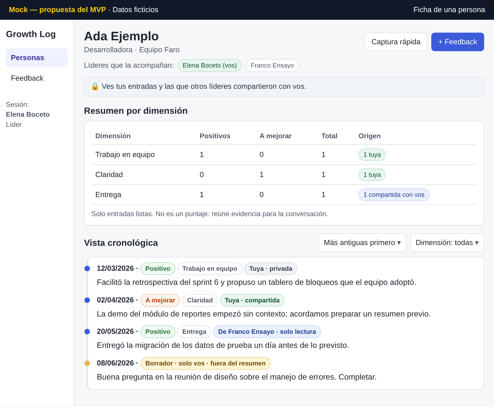
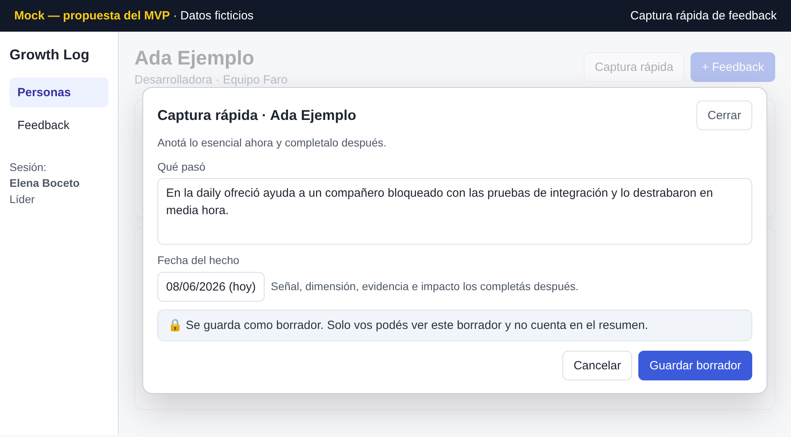
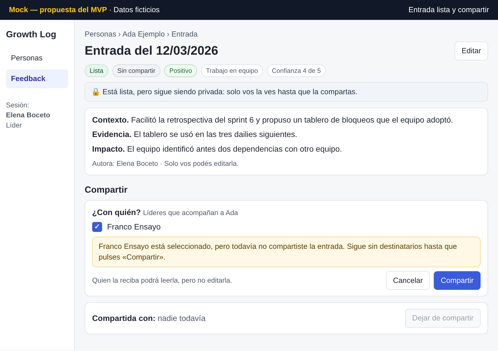
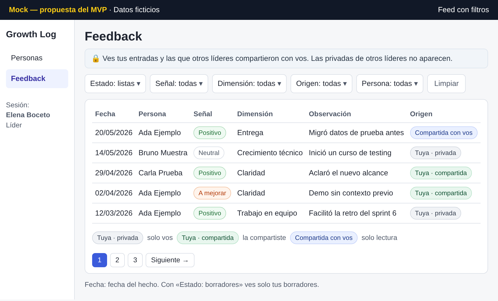
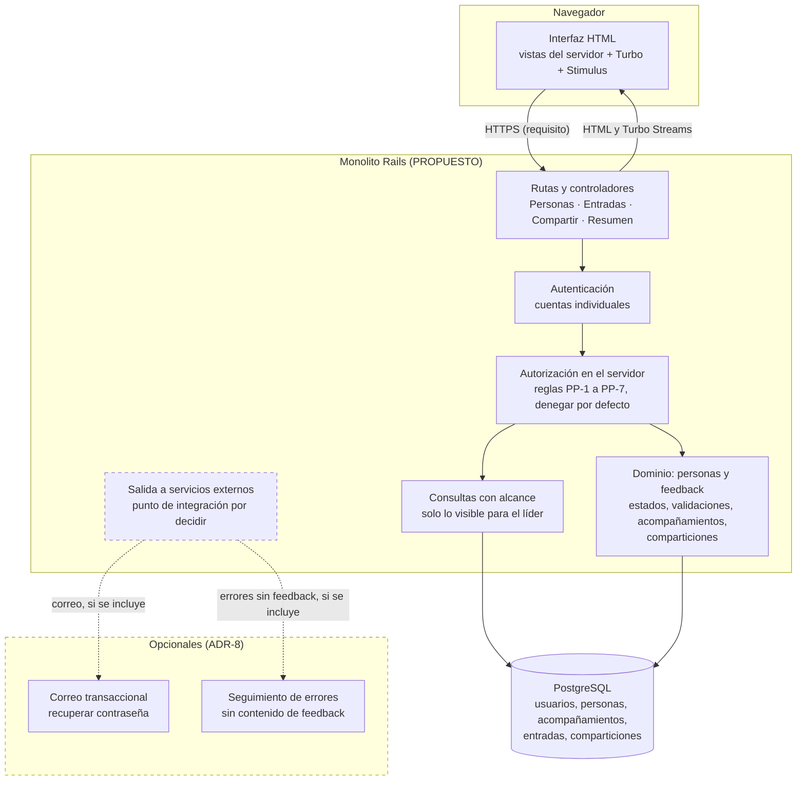
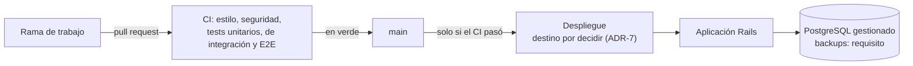
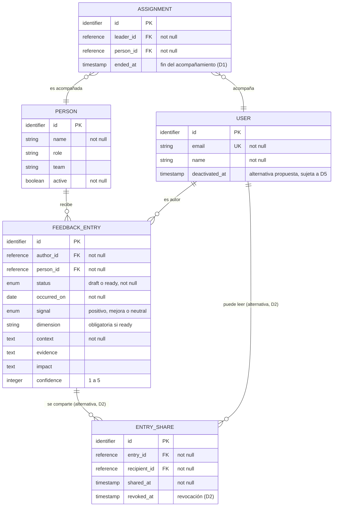

# Growth Log

> **Primera entrega del proyecto final de AI4Devs: documentación.** Todo lo
> que describe es una propuesta para el MVP. Lo marcado **[Por confirmar]**
> es una decisión pendiente de Pablo.

## Growth Log en un minuto

- **Qué es.** Una bitácora web para que **varios líderes** registren feedback
  fechado y concreto sobre las personas que acompañan, y lleguen a los 1:1 y
  a las evaluaciones con evidencia acumulada en lugar de memoria.
- **De dónde sale.** De la visión del producto descrita en la presentación
  «El problema de evaluar de memoria» (10/05/2026).
- **Qué proponemos.** Un MVP de cinco historias con **privacidad por defecto
  y compartición explícita**, diseñado como un monolito web con autorización
  en el servidor. **Todo el diseño de este documento es una propuesta: no
  está construido.**
- **Qué está abierto.** Las decisiones de privacidad **D1 a D5** y varias
  decisiones de arquitectura (sección 9).
- **Qué son hipótesis.** Capturar en unos 30 segundos, reducir el sesgo de
  memoria y mejorar las evaluaciones son **objetivos**, no resultados
  medidos.

**Niveles de evidencia:**

| Marca | Significa |
|---|---|
| **Propuesto** | Diseño del MVP: arquitectura, modelo, stack, política, criterios, tickets y mocks. No está construido. |
| **Hipótesis** | Un beneficio esperado que habrá que validar con usuarios. |
| **Decisión abierta** | Depende de una decisión pendiente (D1 a D5 o un ADR). |

## Documentos complementarios

| Documento | Qué contiene |
|---|---|
| [prompts.md](prompts.md) | Flujos de trabajo con IA: herramienta, modelo, fase, resultado y criterio humano. |
| [Anexo A. Historias en detalle](anexos/anexo-a-historias.md) | Los 52 criterios de aceptación y la política de privacidad con los criterios que la aplican. |
| [Anexo B. Matriz de confiabilidad](anexos/anexo-b-matriz-confiabilidad.md) | 11 capas: el requisito del MVP y lo que falta decidir o validar. |
| [Anexo C. Riesgos y decisiones de privacidad](anexos/anexo-c-riesgos-decisiones.md) | Riesgos del MVP y D1 a D5 en detalle. |
| [Anexo D. Decisiones de arquitectura](anexos/anexo-d-decisiones-arquitectura.md) | Borradores de ADR: contexto, opciones y criterio de cada decisión pendiente. |
| [Anexo E. Notas de los mocks](anexos/anexo-e-mocks.md) | Relación de cada mock con los criterios y las decisiones pendientes. |
| [Anexo F. Registro de prompts](anexos/anexo-f-registro-prompts.md) | Texto de los prompts publicados, con nota de sanitización. |

**Siglas:** H1 a H5, historias; PP-1 a PP-7, política de privacidad
propuesta; D1 a D5, decisiones de privacidad; ADR-1 a ADR-8, decisiones de
arquitectura; HV-1 a HV-6, hipótesis de valor; RN-1 a RN-7, riesgos del MVP.

## Índice

0. [Ficha del proyecto](#0-ficha-del-proyecto)
1. [Descripción general del producto](#1-descripción-general-del-producto)
2. [Arquitectura del sistema](#2-arquitectura-del-sistema)
3. [Modelo de datos](#3-modelo-de-datos)
4. [Especificación de la API y rutas HTTP](#4-especificación-de-la-api-y-rutas-http)
5. [Historias de usuario](#5-historias-de-usuario)
6. [Tickets de trabajo](#6-tickets-de-trabajo)
7. [Pull requests](#7-pull-requests)
8. [Estado de confiabilidad](#8-estado-de-confiabilidad)
9. [Decisiones abiertas y riesgos](#9-decisiones-abiertas-y-riesgos)
10. [Plan de trabajo y uso de IA](#10-plan-de-trabajo-y-uso-de-ia)

---

## 0. Ficha del proyecto

| Campo | Valor |
|---|---|
| 0.1. Nombre completo | Pablo Peuscovich |
| 0.2. Nombre del proyecto | Growth Log. **Proyecto personal de Pablo Peuscovich, autor de la idea.** |
| 0.3. Descripción breve | Bitácora para que varios líderes registren feedback concreto sobre las personas que acompañan y lo usen en 1:1 y evaluaciones. Privacidad por defecto y compartición explícita, como propuesta de diseño. |
| 0.4. URL del proyecto | **Pendiente.** La aplicación todavía no está construida. |
| 0.5. Repositorio | Este repositorio contiene la documentación de la entrega 1; el código se sumará en las entregas siguientes. |

---

## 1. Descripción general del producto

### 1.1. Objetivo

**Fuente de la visión:** «El problema de evaluar de memoria», presentación
de 7 diapositivas fechada el 10/05/2026 (fecha del archivo). No se publica
con esta entrega.

**Problema.** Cuando una evaluación depende de lo que se recuerda del último
mes, se pierde el contexto de los meses anteriores, el feedback valioso no
queda registrado y cuesta respaldar las decisiones con ejemplos concretos.
La presentación también señala más sesgo y menos consistencia entre
evaluadores.

**Para quién:**

| Usuario | Rol | Estado en el MVP |
|---|---|---|
| Líder (varios por instancia) | registra feedback sobre las personas que acompaña, lo revisa y decide qué compartir | **en el MVP** |
| Administrador | asignaría líderes a personas y crearía cuentas | **decisión abierta** (D1) |
| Persona acompañada | es el sujeto del feedback | **sin cuenta en el MVP.** Que vea su propia evolución es una intención de la visión, abierta como D4 |

**Supuesto de adopción (de la visión).** Growth Log no cambia el proceso de
evaluación ni de calibración: cambia cómo se llega a él, con evidencia
acumulada durante el ciclo. **La aplicación no calcula el puntaje de la
evaluación**; la calibración es un uso posible de la evidencia que reúne.

**Hipótesis de valor.** Ninguna está medida; son objetivos a validar.

| # | Qué esperamos | Origen | Evidencia hoy | Cómo se podría verificar (propuesta) |
|---|---|---|---|---|
| HV-1 | Registrar una observación en unos 30 segundos | visión | ninguna medición | cronometrar la captura rápida en una prueba de uso |
| HV-2 | Menos sesgo de memoria: el ciclo completo queda documentado | visión | ninguna | ver si las entradas citadas en una evaluación cubren todo el ciclo, no solo el último mes |
| HV-3 | Evaluaciones más justas y consistentes entre evaluadores | visión | ninguna | piloto con varios líderes y su valoración; no es medible dentro del MVP |
| HV-4 | Feedback más concreto y accionable para los 1:1 | visión | ninguna | revisar con líderes si las entradas incluyen contexto, evidencia e impacto |
| HV-5 | Las personas ven su evolución | visión | — | **fuera del MVP** (D4) |
| HV-6 | No hace falta cambiar el proceso de calibración | visión | ninguna | confirmarlo con los líderes del piloto |

### 1.2. Características y funcionalidades principales

**Recorrido principal del MVP (propuesto):**

| Paso | Historia | Qué hace el líder |
|---|---|---|
| 1 | H1 | ve y mantiene las personas que está autorizado a acompañar |
| 2 | H2 | registra una observación con contexto, evidencia e impacto |
| 3 | H3 | la anota rápido como borrador y la completa después |
| 4 | H4 | revisa la evidencia que puede ver, por dimensión y en orden cronológico, antes de un 1:1 o una evaluación |
| 5 | H5 | explora el feedback que puede ver y comparte el suyo cuando lo decide |

**«Lista» es un estado; compartir es un permiso de lectura:**

| Concepto | Qué indica | Regla propuesta |
|---|---|---|
| **Borrador** | la entrada está incompleta | privado de su autor; no se comparte |
| **Lista** | la entrada está completa | **sigue privada** del autor hasta que la comparta |
| **Compartida** | otro líder puede **leerla** | solo entradas listas; solo el autor edita |

**Política de privacidad propuesta para el MVP.** Propuesta inicial, no
definitiva, y **no implementada**. Regla general: privacidad por defecto y
compartición explícita.

| # | Regla propuesta |
|---|---|
| PP-1 | Cada líder tiene su propia cuenta. |
| PP-2 | Un líder accede a la ficha de una persona si está autorizado a acompañarla. Una persona puede tener más de un líder. |
| PP-3 | Los borradores solo los ve, edita y marca como listos su autor. |
| PP-4 | Una entrada lista sigue siendo privada del autor hasta que este decida compartirla. |
| PP-5 | Una entrada compartida la pueden leer los líderes autorizados a recibirla; solo su autor la edita. |
| PP-6 | El feed y el resumen de una persona muestran únicamente las entradas que el líder tiene permiso para ver. |
| PP-7 | Si un líder deja el equipo o pierde su cuenta, sus entradas no se borran automáticamente. Cómo se conserva o transfiere el acceso queda pendiente de diseño (D5). |

**Decidido para el MVP:** la consulta cronológica de la evidencia forma
parte de H4 (criterio 4.13). **Uso posible, sin funcionalidad propia:** la
calibración; la aplicación no calcula puntajes. **Fuera del MVP:** el acceso
de la persona acompañada (D4) y los enlaces de evidencia externos.

### 1.3. Diseño y experiencia de usuario

**Propuesto:** una navegación con «Personas» y «Feedback». La ficha de cada
persona concentra el resumen por dimensión, el acceso a la captura rápida y
la lista de entradas visibles. Cada entrada muestra si es propia o
compartida. Los textos dicen «Marcar como lista» y «Compartir», nunca
«Publicar», para no confundir marcar como lista con compartir.

**Mocks del recorrido.** Diseño propuesto para el MVP; los permisos y la
compartición aquí mostrados son propuestas.

Las imágenes **no son capturas de un sistema existente**: la aplicación
todavía no está construida. Son pantallas armadas para la entrega, con
nombres, equipos y feedback inventados. Cada una lleva la marca «Mock —
propuesta del MVP · Datos ficticios». La relación de cada pantalla con los
criterios y las decisiones pendientes está en el
[Anexo E](anexos/anexo-e-mocks.md).

**1. Ficha de una persona (H1, H4)**



Resumen por dimensión que distingue entradas propias y compartidas, y vista
cronológica por fecha del hecho (4.13). La lista de líderes muestra una
alternativa de asignación, pendiente de D1. El resumen no es un puntaje.

**2. Captura rápida de feedback (H3)**



Formulario corto desde la ficha. Se guarda como borrador visible solo para
su autor (PP-3, propuesta). Registrar en unos 30 segundos es un objetivo
(HV-1), no un resultado medido.

**3. Entrada lista con la acción de compartir (H5)**



La entrada está lista y sigue sin compartir (PP-4, propuesta). El
destinatario está seleccionado (casilla con tilde), pero la acción no se
confirmó: no hay destinatarios hasta pulsar «Compartir». Quiénes pueden recibirla y cómo se revoca
dependen de D2; la pantalla muestra una alternativa.

**4. Feed con filtros (H5)**



Solo entradas propias y listas compartidas con el líder (PP-6, propuesta),
con filtros por estado, señal, dimensión y origen, y paginación. Las
etiquetas de origen distinguen «Tuya · privada», «Tuya · compartida» y
«Compartida con vos»; la leyenda debajo de la tabla las explica.

### 1.4. Instrucciones de instalación

**No aplica todavía:** el MVP todavía no tiene código. Se documentará al
construirla. La lección 1 no exige instalación en esta entrega.


---

## 2. Arquitectura del sistema

**Todo lo de esta sección es propuesto.** Ningún componente, permiso, CI,
backup ni despliegue del MVP existe todavía; son requisitos hasta que se
implementen y verifiquen.

### 2.1. Diagrama de arquitectura



Lo punteado es opcional y está por decidir: el correo y el seguimiento de
errores son servicios externos propuestos (ADR-8), y qué componente se
conecta con ellos todavía no está definido.

**Por qué un monolito encaja (propuesto).**

- Un equipo de una persona y un producto con pocos usuarios: un solo
  servicio es más simple de construir, probar y desplegar.
- La regla central, quién puede ver qué entrada, vive en un único lugar y se
  aplica igual a vistas, feed y resumen.
- Las vistas renderizadas en el servidor no exponen datos a un cliente que
  luego haya que filtrar.

**Qué se sacrifica:** no hay una API para otros clientes (por ejemplo, una
app móvil para la captura rápida), y la escala queda limitada a un servicio.
Ninguna de las dos cosas hace falta para el MVP.

**Responsabilidades:**

| Componente | Responsabilidad | Historias |
|---|---|---|
| Interfaz | formularios, filtros sin recargar, distinguir lo propio de lo compartido | todas |
| Rutas y controladores | recibir la petición, pedir autorización, delegar en el dominio y elegir la respuesta | todas |
| Autenticación | identificar al líder; sesiones; recuperación de contraseña si se incluye | todas (PP-1) |
| Autorización | decidir si el líder puede ver, editar, marcar como lista o compartir; **denegar por defecto** | H1 a H5 (PP-2 a PP-6) |
| Consultas con alcance | devolver solo personas acompañadas y entradas visibles, para no filtrar en las vistas | H1, H4, H5 |
| Dominio | estados borrador y lista, validaciones, acompañamientos y comparticiones | H2, H3, H5 |
| PostgreSQL | persistencia y restricciones de integridad (claves, unicidad, valores válidos) | todas |

**Decisiones pendientes principales:** biblioteca de autenticación (ADR-2), cómo se implementan las
políticas y qué responde un acceso no autorizado (ADR-3), si se suma Row
Level Security en PostgreSQL (ADR-5), herramienta E2E (ADR-6), despliegue y
backups (ADR-7) y servicios externos (ADR-8). Detalle en el
[Anexo D](anexos/anexo-d-decisiones-arquitectura.md).

### 2.2. Componentes principales y stack

Propuesta inicial para evaluar. **No se fijan versiones:** se elegirán las
estables con soporte vigente al empezar, verificando compatibilidad entre
ellas, con una única versión de Ruby declarada en todo el repositorio.

| Elección | Por qué encaja | Alternativa razonable | Qué falta decidir o comprobar |
|---|---|---|---|
| **Ruby y Rails** | monolito con convenciones maduras para formularios, sesiones, validaciones y tests; conocido por Pablo | Django; Laravel; Node con un framework full-stack | la versión con soporte vigente y una única versión de Ruby declarada en todo el repositorio |
| **ERB y Hotwire** (Turbo y Stimulus) | HTML del servidor, con filtros y formularios sin recargar y poco JavaScript | React o Vue con una API JSON, que obliga a duplicar la autorización en una API | si la captura rápida en el teléfono es suficiente como web adaptable (HV-1) |
| **PostgreSQL** | restricciones de integridad, índices parciales para comparticiones activas y Row Level Security disponible si se decide | SQLite, más simple pero con menos opciones de concurrencia y de backup gestionado | si se usa RLS (ADR-5); proveedor gestionado con backups (ADR-7) |
| **Autenticación: Devise** | completa: sesión, recordarme, recuperación, bloqueo por intentos | el generador de autenticación que trae Rails, más simple y con menos funciones; inicio de sesión con un proveedor externo (OAuth) | ADR-2: qué funciones hacen falta (bloqueo por intentos, recuperación) y quién crea las cuentas (D1) |
| **Autorización: políticas en el servidor** | reglas explícitas y testeables por acción | una biblioteca de políticas (por ejemplo, Pundit o Action Policy) u objetos de política propios | ADR-3: la biblioteca y si un acceso no autorizado responde 404 o 403 |
| **RSpec** (unitarios e integración) | expresivo para especificar reglas de autorización y criterios | Minitest, el que trae Rails | que el CI ejecute la misma suite que se usa en local |
| **E2E: por elegir** | al menos un recorrido completo en un navegador real | tests de sistema de Rails con Capybara; Playwright | ADR-6: herramienta y cómo corre en el CI |
| **GitHub Actions** | CI en cada pull request: estilo, análisis de seguridad, tests; despliegue solo con CI en verde | GitLab CI; CircleCI | que el CI sea **condición** para desplegar |
| **Despliegue: por decidir** | — | una plataforma gestionada o un servidor propio con contenedores | ADR-7: HTTPS forzado, PostgreSQL con backups y una restauración probada, secretos fuera del repositorio |
| **Documentación** | Markdown y diagramas Mermaid en el repositorio | — | — |

### 2.3. Estructura de ficheros

**Propuesta:** la estructura convencional de Rails (`app/models`,
`app/controllers`, `app/views`, `app/javascript`, `config`, `db`, `spec`),
más una carpeta para las políticas de autorización, cuya forma depende de
ADR-3, y `docs/` con las decisiones de arquitectura. Se documentará al crear
el proyecto.

### 2.4. Infraestructura y despliegue

**Propuesto.** Nada de esto existe todavía.



Requisitos de operación: HTTPS forzado en todos los entornos públicos,
chequeo de salud, backups con una restauración probada **antes** de cargar
datos reales, y secretos fuera del repositorio.

### 2.5. Seguridad

**Requisitos del MVP** (propuestos; se verifican con tests al
implementarlos):

- autorización en el servidor, **denegar por defecto**, con un test que
  permite y otro que rechaza por cada regla PP-2 a PP-6;
- consultas con alcance: ninguna vista consulta entradas sin pasar por el
  alcance del líder;
- límite de intentos en el inicio de sesión y la recuperación de contraseña;
- HTTPS forzado y política de seguridad de contenido (CSP);
- el texto del feedback se filtra de los logs y no se envía a servicios
  externos;
- seeds solo para desarrollo.

### 2.6. Tests

**Estrategia propuesta:**

| Nivel | Qué cubre | Ejemplos |
|---|---|---|
| Unitario | modelos y políticas | una entrada lista exige dimensión; un borrador no se comparte; solo el autor edita |
| Integración (peticiones) | autorización por ruta | un líder no asignado no accede a una persona; un destinatario lee pero no edita |
| Recorrido completo (E2E) | al menos uno, en navegador | captura rápida → completar → marcar como lista → compartir → el otro líder la ve en su resumen |

Cada criterio de aceptación del [Anexo A](anexos/anexo-a-historias.md) se
convierte en al menos un test antes de implementarlo.

---

## 3. Modelo de datos

### 3.1. Diagrama del modelo de datos

**Modelo conceptual propuesto, no una migración.** Los tipos son
orientativos y los nombres pueden cambiar. Dos piezas son **alternativas
propuestas, no decisiones**: desactivar a un autor en lugar de borrarlo
(`deactivated_at`, sujeta a D5) y registrar cada compartición como una fila
por destinatario (`ENTRY_SHARE`, sujeta a D2).



**Cardinalidades:** un líder acompaña a cero o más personas y una persona
puede tener varios líderes (N:M a través de `ASSIGNMENT`). Si una persona
debe tener al menos un líder depende de D1. Cada entrada tiene **exactamente
un autor** y **exactamente una persona**. Una entrada se comparte con cero o
más líderes; en la alternativa propuesta, cada uno es una fila de
`ENTRY_SHARE` (D2).

**Visibilidad:** la entrada no tiene un campo de visibilidad; quién puede
leerla se deriva de las comparticiones. Si hace falta algo equivalente a
«escalar» es la decisión D3.

### 3.2. Descripción de entidades principales

| Entidad | Responsabilidad | Restricciones necesarias |
|---|---|---|
| `USER` (líder) | identifica a quien usa la aplicación y es autor o destinatario | `email` único y obligatorio; qué pasa con sus entradas si deja el equipo depende de D5 (alternativa propuesta: desactivarlo en lugar de borrarlo) |
| `PERSON` | persona acompañada; sujeto del feedback | `name` obligatorio; baja lógica con `active` |
| `ASSIGNMENT` | autoriza a un líder a acompañar a una persona (PP-2) | par líder y persona único mientras esté activo; ambas claves obligatorias |
| `FEEDBACK_ENTRY` | una observación sobre una persona | autor y persona obligatorios; `status` restringido a `draft` o `ready` en la base; `context` y `occurred_on` obligatorios; dimensión obligatoria si `ready`; `confidence` de 1 a 5 |
| `ENTRY_SHARE` | otorga **permiso de lectura** sobre una entrada a un líder. **Alternativa propuesta, sujeta a D2** | una sola compartición activa por entrada y destinatario; el destinatario no es el autor; solo entradas `ready` |

**Reglas que cruzan entidades** (se garantizan en la aplicación y con tests,
porque la base no puede expresarlas todas):

| Regla | De dónde sale | Dónde se garantiza |
|---|---|---|
| Un líder ve una entrada si es su autor, o si está lista y compartida con él sin revocar | PP-3 a PP-6 | política y consultas con alcance |
| Solo el autor edita, marca como lista o comparte | PP-3, PP-5 | política |
| Un borrador no se comparte | 3.9 | dominio y política |
| Solo se registra feedback sobre una persona que el líder acompaña | PP-2, 2.10 | política |
| Acompañar a una persona no da acceso a lo privado de otro líder | 4.11 | consultas con alcance |

**Qué depende de decisiones abiertas:**

- **D1, asignación:** quién crea `ASSIGNMENT`, si hay administradores y qué
  pasa con el acceso al terminar un acompañamiento (`ended_at`).
- **D2, compartición y revocación:** si el destinatario tiene que acompañar
  a la persona, si se comparte con líderes uno a uno (alternativa propuesta:
  una fila por destinatario) o con todos los de la persona, y si revocar
  borra el registro o marca `revoked_at`.
- **D5, salida de un autor:** si sus entradas quedan solo legibles para
  quienes ya las tenían, se transfieren o se archivan. Desactivar al autor
  en lugar de borrarlo es la alternativa propuesta; otras son transferir
  sus entradas a otro líder o archivarlas.

---

## 4. Especificación de la API y rutas HTTP

**El MVP no propone una API JSON.** Las operaciones se exponen como rutas
HTML del monolito; si más adelante hiciera falta una API, sería una decisión
nueva. Estas tres operaciones principales se describen en formato OpenAPI
como **contrato propuesto**, no implementado:

```yaml
openapi: 3.0.3
info:
  title: Growth Log MVP (rutas HTML propuestas)
  version: "propuesta"
paths:
  /people/{person_id}/entries:
    post:
      summary: Registrar una entrada (completa o captura rápida) sobre una persona acompañada
      parameters:
        - { name: person_id, in: path, required: true, schema: { type: string } }
      requestBody:
        content:
          application/x-www-form-urlencoded:
            schema:
              type: object
              required: [context, occurred_on]
              properties:
                context: { type: string }
                occurred_on: { type: string, format: date }
                signal: { type: string, enum: [positive, improvement, neutral] }
                dimension: { type: string }
                evidence: { type: string }
                impact: { type: string }
                confidence: { type: integer, minimum: 1, maximum: 5 }
                status: { type: string, enum: [draft, ready], default: draft }
      responses:
        "302": { description: Guardada como borrador o lista; privada del autor }
        "422": { description: Datos inválidos; vuelve a mostrar el formulario }
        "404": { description: "El líder no acompaña a la persona (404 o 403: ADR-3)" }
  /entries/{id}/ready:
    patch:
      summary: Marcar como lista una entrada propia
      parameters:
        - { name: id, in: path, required: true, schema: { type: string } }
      responses:
        "302": { description: Marcada como lista; sigue privada }
        "422": { description: Le faltan datos; sigue como borrador y se indica qué falta }
        "404": { description: No es del líder }
  /entries/{id}/shares:
    post:
      summary: Compartir una entrada lista con otro líder
      parameters:
        - { name: id, in: path, required: true, schema: { type: string } }
      requestBody:
        content:
          application/x-www-form-urlencoded:
            schema:
              type: object
              required: [recipient_id]
              properties:
                recipient_id: { type: string, description: "quiénes pueden recibirla: D2" }
      responses:
        "302": { description: Compartida; el destinatario puede leerla }
        "422": { description: "La entrada es un borrador o el destinatario no es válido" }
        "404": { description: No es del líder }
```

**Rutas propuestas por historia:**

| Historia | Rutas |
|---|---|
| H1 | listar, ver, crear y editar personas acompañadas |
| H2 | formulario y creación de entradas sobre una persona |
| H3 | captura rápida, edición de un borrador propio y `PATCH` para marcar como lista |
| H4 | ficha de la persona con resumen, entradas visibles en orden cronológico y detalle de una entrada visible |
| H5 | feed con filtros; compartir (`POST`) y revocar (`DELETE`, sujeto a D2) |

Todas exigen sesión, salvo el chequeo de salud.

---

## 5. Historias de usuario

Documentamos las **cinco** historias del MVP (la lección admite de 3 a 5).
Aquí van el enunciado, tres criterios clave y cómo las cubre el diseño. Los
52 criterios completos están en el [Anexo A](anexos/anexo-a-historias.md).

**H1. Mantener la lista de personas que acompaño.** Como líder, quiero tener
al día la lista de personas que acompaño, para registrar feedback sobre cada
una.

- Veo las personas activas que estoy autorizado a acompañar, con su rol y
  equipo.
- No accedo a la ficha de una persona que no acompaño (PP-2).
- Doy de baja a una persona sin perder su historial.

**H2. Registrar feedback estructurado.** Como líder, quiero registrar una
observación fechada y concreta sobre una persona que acompaño, para acumular
evidencia.

- El formulario pide contexto y fecha, y ofrece señal, dimensión, evidencia,
  impacto y confianza.
- Quedo registrado como autor, siempre.
- La entrada queda privada: solo yo la veo hasta compartirla (PP-3, PP-4).

**H3. Capturar rápido y completar después.** Como líder, quiero anotar algo
en el momento con lo mínimo y completarlo más tarde, para no perder la
observación.

- Tengo un acceso visible a la captura rápida desde la ficha; se guarda como
  borrador privado de mi autoría con la fecha de hoy.
- Si marco como lista una entrada incompleta, veo qué falta y sigue como
  borrador.
- Un borrador no se comparte y no cuenta en el resumen.

**H4. Preparar una evaluación o un 1:1.** Como líder, quiero ver la evidencia
que puedo ver sobre una persona, organizada por dimensión y en el tiempo,
para preparar una evaluación o un 1:1.

- El resumen suma solo mis entradas listas y las listas compartidas conmigo,
  y distingue unas de otras.
- Recorro esa evidencia en orden cronológico, por la fecha en que ocurrió
  cada hecho (4.13).
- Acompañar a una persona no me da acceso a lo privado de otro líder (4.11).
- Dos líderes pueden ver resúmenes distintos de la misma persona (4.12).

La calibración es un uso posible de esta evidencia; la aplicación no
calcula el puntaje de la evaluación.

**H5. Explorar y compartir feedback.** Como líder, quiero recorrer y filtrar
el feedback que puedo ver, y compartir el mío cuando lo decida, para
detectar patrones y coordinarme con otros líderes.

- El feed muestra solo mis entradas y las listas compartidas conmigo.
- Comparto una entrada lista; el destinatario la lee y no la edita.
- Cómo se eligen los destinatarios y cómo se revoca depende de D2.

**Cómo las cubre el diseño:**

| Historia | Componentes | Entidades | Reglas | Tests propuestos | Ticket |
|---|---|---|---|---|---|
| H1 | personas, autorización, consultas con alcance | `PERSON`, `ASSIGNMENT` | PP-2; D1 | un líder no asignado no ve ni abre la persona | MVP-DB-1 |
| H2 | entradas, autorización, dominio | `FEEDBACK_ENTRY` | PP-2 a PP-4 | validaciones; crear sobre una persona no acompañada es rechazado | MVP-DB-1, MVP-BE-1 |
| H3 | interfaz, entradas, dominio | `FEEDBACK_ENTRY.status` | PP-3; 3.9 | recorrido E2E de captura rápida a lista; lista exige dimensión | MVP-FE-1 |
| H4 | resumen, consultas con alcance | `FEEDBACK_ENTRY` (`occurred_on`), compartición, `ASSIGNMENT` | PP-5, PP-6; 4.11 a 4.13 | dos líderes ven resúmenes distintos; la vista cronológica solo incluye entradas visibles | MVP-BE-1 |
| H5 | feed, compartir, autorización | `ENTRY_SHARE` | PP-4 a PP-6; D2, D3 | compartir un borrador es rechazado; el destinatario lee y no edita | MVP-BE-1, MVP-DB-1 |

---

## 6. Tickets de trabajo

Los tres tickets que pide la plantilla (base de datos, backend y frontend)
dependen de decisiones todavía abiertas.

### MVP-DB-1. Modelo de acompañamiento, autoría y compartición (base de datos)

- **Historias:** H1, H2, H5. **Reglas:** PP-2 a PP-7.
- **Condición:** se implementa **después** de resolver D1, D2 y D5.
- **Preguntas que la base tiene que poder responder:**
  1. ¿Qué líderes acompañan hoy a esta persona? Puede haber más de uno.
  2. ¿Quién es el autor de esta entrada? Siempre hay uno.
  3. ¿Con quién está compartida esta entrada y desde cuándo?
  4. ¿Qué pasa con las entradas de un líder que deja el equipo?
- **Alcance:** las entidades de la sección 3 según cómo se resuelvan D2 y D5,
  con claves foráneas, unicidad del acompañamiento y de la compartición
  activa, `status` restringido en la base y el autor obligatorio.
- **Pasos:**
  1. Registrar en un ADR las decisiones D1, D2 y D5 que afectan al modelo.
  2. Escribir los tests de modelo a partir de las restricciones de la sección
     3.2.
  3. Migraciones reversibles, con índices para las consultas de visibilidad
     (por autor, por persona y por destinatario).
  4. Seeds solo para desarrollo, con datos ficticios.
- **Criterios de aceptación:**
  - la base responde las cuatro preguntas;
  - no se puede guardar una entrada sin autor o sin persona, ni un estado
    fuera de `draft` y `ready`;
  - no se pueden duplicar un acompañamiento activo ni una compartición
    activa;
  - las migraciones se revierten en desarrollo sin pérdida;
  - los tests de modelo pasan en el CI.
- **Fuera de alcance:** hacer cumplir las reglas en controladores y vistas
  (MVP-BE-1).

### MVP-BE-1. Autorización de lectura y edición de entradas en el servidor (backend)

- **Historias:** H2, H4, H5. **Reglas:** PP-3 a PP-6; criterios 4.11 y 4.12.
- **Depende de:** MVP-DB-1 y ADR-3.
- **Regla:** un líder **ve** una entrada si es su autor, o si está lista y
  compartida con él sin revocar. Solo el autor la **edita**, la **marca como
  lista** o la **comparte**. Todo lo demás se deniega.
- **Pasos:**
  1. Escribir los tests de peticiones: un caso permitido y uno rechazado por
     regla, en detalle, edición, marcar como lista, compartir, feed y
     resumen.
  2. Implementar la política y una consulta con alcance que usen todas las
     acciones.
  3. Responder ante un acceso no autorizado según ADR-3, sin revelar si la
     entrada existe.
- **Criterios de aceptación:**
  - **Dado** un borrador de otro líder, **cuando** intento abrirlo,
    **entonces** no accedo.
  - **Dado** una entrada lista no compartida conmigo, **cuando** abro el
    resumen de la persona, **entonces** no la cuenta (4.11).
  - **Dado** una entrada compartida conmigo, **cuando** intento editarla,
    **entonces** no puedo.
  - **Dado** dos líderes de la misma persona con comparticiones distintas,
    **entonces** sus resúmenes difieren (4.12).
  - Ninguna acción de entradas queda sin cubrir por la política, comprobado
    por un test.
- **Fuera de alcance:** la interfaz para elegir destinatarios (depende de D2).

### MVP-FE-1. Captura rápida accesible desde la ficha (frontend)

- **Historia:** H3. **Hipótesis relacionada:** HV-1.
- **Depende de:** MVP-DB-1.
- **Contexto:** la captura rápida solo sirve si está a la vista desde la
  ficha; sin un acceso visible, no se usa.
- **Pasos:**
  1. Escribir el test E2E del recorrido.
  2. Botón «Captura rápida» en la ficha de la persona; formulario corto con
     el texto y la fecha de hoy.
  3. Al guardar, borrador privado y vuelta a la ficha con un aviso.
  4. Desde el borrador, completar y «Marcar como lista»; si falta algo, se
     muestra qué falta.
- **Criterios de aceptación:**
  - **Dado** que estoy en la ficha, **cuando** elijo «Captura rápida»,
    **entonces** se abre el formulario corto sin salir de la página.
  - **Cuando** guardo, **entonces** queda como borrador privado y vuelvo a la
    ficha.
  - **Cuando** marco como lista una entrada sin dimensión, **entonces** sigue
    como borrador y veo qué falta.
  - Ningún texto de la interfaz dice «Publicar».
  - Un test E2E cubre el recorrido.
- **Validación aparte (no es criterio de aceptación):** cronometrar la
  captura en una prueba de uso para contrastar HV-1.

---

## 7. Pull requests

Todavía no hay pull requests del MVP. Corresponden a las entregas
siguientes.

---

## 8. Estado de confiabilidad

Usamos las 11 capas de una lista **inspirada en la publicación compartida
por Igor Buinevici** en LinkedIn, que atribuye la idea a **Manthan Patel**.
Las capas salen de esa lista; **los estados y el análisis son nuestros**. La
matriz completa está en el
[Anexo B](anexos/anexo-b-matriz-confiabilidad.md).

| # | Capa | Requisito del MVP (propuesto) | Pendiente |
|---|---|---|---|
| 1 | Límite de peticiones | limitar intentos de inicio de sesión y de recuperación | mecanismo y umbrales |
| 2 | Caché y CDN | no requerido para el volumen esperado | medir antes de agregar |
| 3 | Backups y recuperación | backups y una restauración probada antes de cargar datos reales | proveedor y retención (ADR-7) |
| 4 | Optimización de la base | índices para las consultas de visibilidad; paginación | medir con datos de prueba |
| 5 | Disponibilidad | chequeo de salud | según el hosting (ADR-7) |
| 6 | CI/CD | CI en cada PR; despliegue solo en verde | destino de despliegue (ADR-7) |
| 7 | Balanceo y escalado | una instancia alcanza | — |
| 8 | Errores y monitoreo | seguimiento de errores sin contenido de feedback | herramienta (ADR-8) |
| 9 | Seguridad y RLS | autorización en el servidor, denegar por defecto | RLS como segunda defensa (ADR-5) |
| 10 | Autenticación y permisos | cuentas individuales y política PP | autenticación (ADR-2); quién crea las cuentas (D1) |
| 11 | Hosting | HTTPS, PostgreSQL gestionado, secretos fuera del repositorio | proveedor (ADR-7) |

Ningún requisito está implementado todavía.

---

## 9. Decisiones abiertas y riesgos

### 9.1. Decisiones de privacidad

| # | Decisión | Qué bloquea |
|---|---|---|
| D1 | **Asignación y administración:** quién asigna líderes a personas, si habrá administradores, quién crea las cuentas y qué pasa al terminar un acompañamiento. | H1, MVP-DB-1 |
| D2 | **Destinatarios y revocación:** con quién se puede compartir (líderes de la persona, líderes elegidos, todos) y cómo se revoca. | H5, MVP-DB-1, MVP-BE-1 |
| D3 | **Escalar:** si hace falta algo más que compartir, por ejemplo escalar un caso. | H5 |
| D4 | **Acceso de la persona acompañada** a su propio feedback. | ninguno del MVP |
| D5 | **Salida de un autor:** cómo se conservan o transfieren sus entradas (PP-7). | MVP-DB-1 |

### 9.2. Decisiones de arquitectura y de producto

| # | Decisión | Estado |
|---|---|---|
| ADR-1 | Monolito Rails con HTML del servidor | propuesta |
| ADR-2 | Autenticación: Devise o la de Rails | abierta |
| ADR-3 | Implementación de políticas y respuesta ante acceso no autorizado | abierta |
| ADR-4 | Cómo se registra una compartición: filas por destinatario u otra forma | abierta; alternativa propuesta sujeta a D2 |
| ADR-5 | Row Level Security en PostgreSQL | abierta |
| ADR-6 | Herramienta E2E | abierta |
| ADR-7 | Despliegue y backups | abierta |
| ADR-8 | Servicios externos: correo y seguimiento de errores | abierta |
| — | Consulta cronológica de la evidencia | **decidida:** en H4 (4.13) |
| — | Calibración | uso posible; la aplicación no calcula puntajes |

Contexto, opciones y criterio de cada ADR: [Anexo D](anexos/anexo-d-decisiones-arquitectura.md).

### 9.3. Riesgos principales

- **RN-1. Fuga de feedback por una acción sin política.** Mitigación:
  denegar por defecto y un test que recorre todas las acciones.
- **RN-2. «Lista» confundida con «compartida».** Mitigación: textos
  separados y un aviso al compartir.
- **RN-3. Hipótesis de valor sin validar** (HV-1 a HV-4). Mitigación:
  pruebas de uso y un piloto antes de ampliar el alcance.

Todos los riesgos están en el
[Anexo C](anexos/anexo-c-riesgos-decisiones.md).

---

## 10. Plan de trabajo y uso de IA

**Propuesto.** Pablo define el objetivo y toma las decisiones; la IA asiste
en el análisis, la especificación, la implementación y la revisión, y cada
fase tiene una verificación humana o automática.

| Fase | Qué se hace | Uso de IA | Verificación |
|---|---|---|---|
| 0. Documentación (entrega 1) | visión, MVP, arquitectura y modelo propuestos | análisis de la visión, redacción y revisión de coherencia | revisión de Pablo; enlaces y datos sensibles |
| 1. Decisiones | resolver D1, D2, D5 y los ADR abiertos | comparar opciones con sus consecuencias | Pablo decide y se registra en un ADR |
| 2. Especificación ejecutable | criterios de aceptación → tests que fallan | proponer tests desde los criterios | Pablo revisa que cada test refleje su criterio |
| 3. Modelo y autorización | MVP-DB-1 y MVP-BE-1 primero | implementar hasta pasar los tests | CI en verde; test de cobertura de la política |
| 4. Historias | H2 y H3, luego H4, H5 y H1 | implementar e iterar | tests de cada criterio y el E2E |
| 5. Operación | CI como condición, despliegue y backups | configurar el pipeline | una restauración de backup probada |
| 6. Validación | pruebas de uso y piloto | preparar guiones y resumir resultados | HV-1 a HV-4 contrastadas con usuarios |

Los flujos de IA ya usados en esta entrega están en
[prompts.md](prompts.md).
